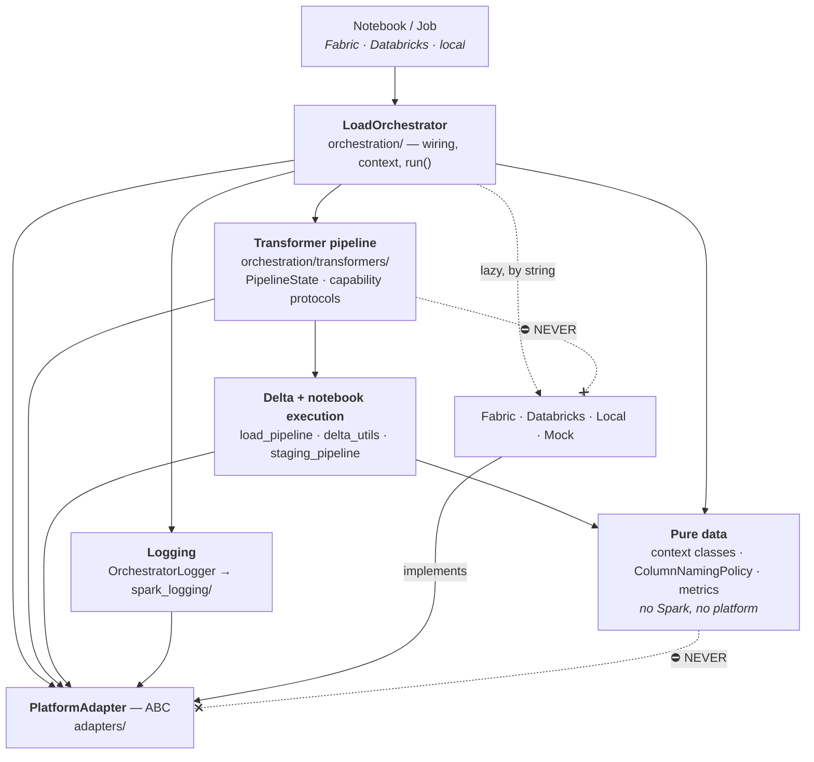

# Claude Project Instructions — spark_quick_start

> This file is a thin index. The rules and standards it points to live as individual files
> under `.claude/rules/` and `.claude/standards/` — open the linked file when its row applies,
> the one-line constraint in the table is what tells you it does.
>
> **rule** = a hard constraint; violating it is a bug (boundaries, contracts, invariants).
> **standard** = a convention; violating it is a review comment (shape, style, practice).
> Every rule below is backed by a test under `tests/architecture/` — a violation is caught
> whether or not anyone reads the file it lives in.

---

## 1. What this repo is

A Python/PySpark library for metadata-driven data engineering, imported from notebooks on
**Microsoft Fabric** and **Azure Databricks** (classic *and* serverless / Spark Connect).
One JSON load context drives a full entity load: run staging notebooks → read the target
Delta table → classify rows new/changed/deleted → SCD1/SCD2 merge → persist logs → return
`ExecutionResult` JSON to the calling pipeline.

It ships two ways and both must keep working — as a wheel, and as `./src/` copied onto
`sys.path` (see [`dual-shipping`](.claude/rules/dual-shipping.md)).

Portability is the product. Any change that works on one platform only is a bug unless it
sits behind an adapter.

### Module map

| Path                            | Role                                                                                   |
| ------------------------------- | -------------------------------------------------------------------------------------- |
| `orchestration/`              | `LoadOrchestrator`, transformer pipeline, Delta/SCD execution, context parsing       |
| `orchestration/transformers/` | The 26 shipped pipeline steps + their ABCs and protocols                               |
| `adapters/`                   | `PlatformAdapter` ABC + `Fabric`/`Databricks`/`Local`/`Mock` implementations |
| `logger/`                     | `OrchestratorLogger` — one per run, injectable                                      |
| `spark_logging/`              | `LogSession` capture + pluggable `LogPersistenceAdapter` backends                  |
| `local_notebookutils/`        | Local stub of `notebookutils` for dev/CI                                              |
| `spark_load_orchestration.py` | Back-compat shim. Re-exports only. Do not grow it.                                     |

---

## 2. Layering and dependency direction

Read it as: **every solid edge points down or right into an abstraction; nothing points back
up.** The two ⛔ edges, drawn as crossed dotted arrows, are the bans that [`platform-boundary`](.claude/rules/platform-boundary.md)
enforces, drawn so they do not get re-invented.

---

## 3. The floor — never direct execution

Before any judgement call on plan mode vs. direct execution, the hard floor. Direct
execution is wrong for these regardless of how small the diff looks, because the cost of
being wrong is not a rework — it is corrupted customer data or a broken gate:

| Never direct-execute                                                                           | Why                                                                                                                                            |
| ---------------------------------------------------------------------------------------------- | ---------------------------------------------------------------------------------------------------------------------------------------------- |
| Anything that changes SCD output — hashing, versioning, change classification, close-out rows | Tables already written under the old behaviour do not get re-derived. A wrong version bump is permanent history.                               |
| Anything crossing the platform boundary — a new adapter method, a new platform SDK call       | Cannot be proven here. Four runtime combinations (Fabric/Databricks × classic/serverless) and the suite exercises none of them live.          |
| The ruff `ignore` list, `mypy-baseline.txt`, or the coverage `omit` list                  | Each is a gate. Editing one changes what CI is allowed to miss, which is a decision, not a fix.                                                |
| Anything that moves or renames a field on a context class                                      | The load-context JSON is written by pipelines outside this repo. A rename without a rejecting migration branch fails in production, not in CI. |

---

## 4. Rules — violating one is a bug

| Rule                                                               | The constraint                                                                                                                                                                 | Enforced by                                         |
| ------------------------------------------------------------------ | ------------------------------------------------------------------------------------------------------------------------------------------------------------------------------ | --------------------------------------------------- |
| [`layering`](.claude/rules/layering.md)                           | Dependencies point down and inward; transformers reach Delta only through `_pipeline.py` and constants only through `_constants.py`; the DQD library imports only PySpark and itself | `tests/architecture/test_layering.py`             |
| [`platform-boundary`](.claude/rules/platform-boundary.md)         | Platform SDKs appear only in `adapters/*_adapter.py` and `spark_logging/*_persistence.py`, always inside a method body; new capability is a new `PlatformAdapter` method  | `tests/architecture/test_platform_boundary.py`    |
| [`dual-shipping`](.claude/rules/dual-shipping.md)                 | Works installed from the wheel*and* as `./src/` on `sys.path` with nothing but PySpark; every optional dependency guarded; nothing reads installed metadata              | `tests/architecture/test_dual_shipping.py`        |
| [`transformer-contract`](.claude/rules/transformer-contract.md)   | Never override `produce()`/`__call__()`; services injected at `.run()` time; `PipelineState` immutable; optional capabilities are protocols                             | `tests/architecture/test_transformer_contract.py` |
| [`data-contract`](.claude/rules/data-contract.md)                 | `_change_type`, `_prev_scdVersion` and the frames key are each defined once, in `_constants.py`, and configurable on all sides or none                                   | `tests/architecture/test_data_contract.py`        |
| [`spark-delta-cost`](.claude/rules/spark-delta-cost.md)           | Cache gated on `serverless`; never `count()` for metrics; every Spark action is a cost decision stated in the docstring; destructive ops guarded                            | **none — judgement.** `/review-pr`         |
| [`release-and-branching`](.claude/rules/release-and-branching.md) | Never branch from `release/*`; `filter_platform_release.sh` is the single source of truth for platform builds                                                               | `tests/architecture/test_release_filter.py`       |
| [`test-classification`](.claude/rules/test-classification.md)     | Three suites split by scope — unit, integration, architecture; markers stamped from the directory, never by hand                                                              | `tests/architecture/test_test_classification.py`  |

---

## 5. Standards — violating one is a review comment

| Standard                                                                       | Covers                                                                                  |
| ------------------------------------------------------------------------------ | --------------------------------------------------------------------------------------- |
| [`module-layout`](.claude/standards/module-layout.md)                         | `__future__` annotations, house docstring header, `__all__`, import placement       |
| [`api-and-typing`](.claude/standards/api-and-typing.md)                       | Type hints, keyword-only flags, dataclasses, public re-export, composition over inheritance |
| [`docstrings-and-comments`](.claude/standards/docstrings-and-comments.md)     | Google-style docstrings; comment the why, carry the measurement                         |
| [`errors-and-logging`](.claude/standards/errors-and-logging.md)               | Loud actionable errors, the single swallow point, logger over `print`                  |
| [`configuration-and-context`](.claude/standards/configuration-and-context.md) | The context sections, where new config goes,`ColumnNamingPolicy` SSOT            |
| [`testing`](.claude/standards/testing.md)                                     | `MockPlatformAdapter`, `spark` marker, boundary assertions, coverage gate           |
| [`tooling-and-gates`](.claude/standards/tooling-and-gates.md)                 | Verification commands; ruff-ignore and mypy-baseline policy                             |
| [`spark-performance`](.claude/standards/spark-performance.md)                 | Actions, UDFs, partitioning, joins, shuffle width,`MERGE` predicates, schema handling |

---

## 8. Known debt — carve-outs, not precedents

| Item                                                                                                 | Status                                                                                                                                                                                                                                                                                                                                                                                            |
| ---------------------------------------------------------------------------------------------------- | ------------------------------------------------------------------------------------------------------------------------------------------------------------------------------------------------------------------------------------------------------------------------------------------------------------------------------------------------------------------------------------------------- |
| `Constants` duplicated in `models.py` and `transformers/_constants.py`                         | Deliberate decoupling; both derive from `ColumnNamingPolicy.default()`. Edit both or neither.                                                                                                                                                                                                                                                                                                    |
| `spark_logging._CURRENT` module global                                                             | Documented reason (cross-module `global` aliasing). Do not add more globals.                                                                                                                                                                                                                                                                                                                     |
| mypy baseline — **201 errors** across 132 baseline lines, mostly injected-service `X \| None` | Tracked as issue #34; fixing the injection typing clears most of it. The number came from `python scripts/mypy_baseline.py`, which is the only authority — the file's line count is not the error count, and this table said 255 for long enough that F15 was opened about it. 25 of the 201 are currently reported as fixed (measured 2026-10-03, after F197 removed the append writer) and the baseline is deliberately not shrunk here: it is a gate file (§3). |
