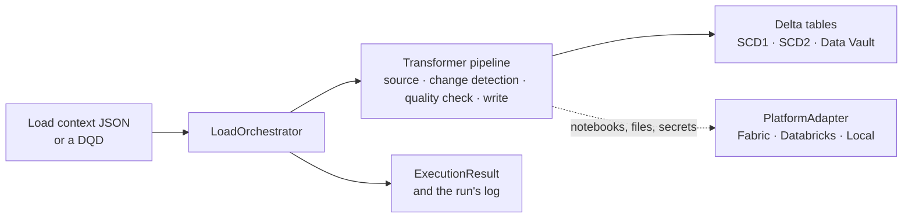

# Spark Quick Start

Spark Quick Start is an open-source framework from Iteration Insights for repeatable Spark data
engineering on **Microsoft Fabric** and **Azure Databricks**. Instead of writing custom
orchestration, SCD handling, logging and platform plumbing for every table, you describe each
load in a JSON load context and run it through one tested pipeline, the same on both platforms.

> **Project status: Public Preview / Beta.** The framework is actively used and developed, but its
> API may change before 1.0. Pin a release version rather than tracking `main`.

## Why Spark Quick Start

Spark Quick Start grew out of repeated Microsoft Fabric and Databricks analytics implementations,
where teams kept solving the same infrastructure problems: load orchestration, SCD processing,
metadata handling, logging, incremental loading and platform integration. The framework captures
those patterns, so a new project starts from an established engineering foundation rather than an
empty notebook, and the team spends its time on source-to-target logic and business modelling.

What you get: standardized loads, less repetitive plumbing, consistent logging and error handling,
and patterns that carry across Fabric and Databricks. It is extensible rather than prescriptive.

### A typical project

A team is building a lakehouse warehouse on Fabric or Databricks: tens to hundreds of tables,
several engineers, and a Silver layer of Inmon-style normalized entities or a Data Vault, with full
change history. Gold dimensions and facts come later, built on that history. Written table by
table, the loads drift apart: each lands data differently, handles deletes differently, logs
differently, and a changed setting silently re-versions a table's history.

With Spark Quick Start every table is a JSON load context run through the same pipeline. Bronze
loads need no staging notebook: with a Declarative Query Definition as the pipeline's source, the
load reads a landing folder of parquet files, a catalog view (federated sources included, on
Databricks) or a Delta table, and adds, casts and renames columns row by row on the way in. The same mechanism covers Silver tables that need no
joins or aggregation. Silver history is written by shipped SCD2 and Data Vault steps, which seal
their settings on the table at its first write and refuse a later load that differs. Every run
returns the same `ExecutionResult`, with per-step timings and counts, and writes its log in the
same schema, so the whole estate reports in one shape.

When a table's business rules differ, you compose its pipeline: add your own steps between the
shipped source, guards and writers, rather than fork the framework. The policies come with those
steps, so a pipeline that keeps them keeps the policy.

## What it does

- **SCD1 and SCD2 loads into Delta tables.** `default_pipeline` runs staging notebooks, reads the
  target, classifies rows as new, changed or deleted, and merges them.
- **Data Vault 2.0 hubs, links and satellites**, insert-only, through `dv_hub_pipeline`,
  `dv_link_pipeline` and `dv_satellite_pipeline`.
- **Declarative Query Definitions (DQD).** Load a table with no staging notebook, by composing
  `DQDTransformer` as the pipeline's source
  ([guide](docs/guides/load-a-table-with-a-dqd.md)): from a parquet landing folder, a catalog view or a Delta table, with new,
  cast and renamed columns, one row in and one row out. It suits Bronze, and Silver tables that
  need no joins or aggregation.
- **Structured logging and results.** Every run writes through one `OrchestratorLogger` and
  returns an `ExecutionResult` your pipeline can read, with per-step timings and counts.
- **Platform abstraction.** Every platform call goes through a `PlatformAdapter`, so the same load
  code runs on Fabric, Databricks and your own machine.

## What it is, and what it isn't

| Spark Quick Start is                              | Spark Quick Start is not                     |
| ------------------------------------------------- | -------------------------------------------- |
| A reusable Spark data-engineering framework       | A managed SaaS product                       |
| An accelerator for Fabric and Databricks projects | A replacement for Fabric or Databricks       |
| A metadata-driven loading framework               | A complete enterprise data platform          |
| A set of tested engineering patterns              | An automatic business data modeller          |
| An extensible foundation                          | A fixed, prescribed architecture             |
| An open-source consulting asset                   | A commercially supported product with an SLA |

Use it when you are building lakehouse loads on Fabric or Databricks and want every entity loaded
the same way, with the same logging and the same result, without building that framework yourself.

## Architecture at a glance

A load context, or a DQD, goes in. A pipeline of steps writes the target Delta table. A result
comes out. The platform is reached only through the adapter.



Read it as: the orchestrator builds and runs the pipeline, the pipeline writes the tables, and only
the adapter knows which platform it is on. In a Bronze, Silver and Gold lakehouse, Spark Quick Start
handles the repeatable loads into Bronze, Silver and Data Vault tables, from landing files, catalog
views or upstream Delta tables. It stores the model you design, Inmon-style or Data Vault, with its
history; Gold dimensions, facts and business transformation stay project-specific. The full picture is the
[architecture overview](docs/architecture/overview.md).

## Platforms

Microsoft Fabric and Azure Databricks, on classic and serverless compute, and a local machine for
development and CI. The library code is the same everywhere; only the adapter differs.

| Feature              | Microsoft Fabric | Azure Databricks |                            Local / CI                            |
| -------------------- | :---------------: | :--------------: | :--------------------------------------------------------------: |
| `default_pipeline` |        ✓        |        ✓        |                        ✓ (LocalAdapter)                        |
| Parallel staging     |        ✓        |        ✓        |                           ✓ (threads)                           |
| Notebook execution   | `notebookutils` |   `dbutils`   | registered callables, or `.ipynb` files from `notebooks_dir` |
| Delta Lake           |        ✓        |        ✓        |                         `delta-spark`                         |

The platform release wheels leave out `LocalAdapter` and the `local` extra. To develop or test
locally, use a source copy or a checkout of `main`, as the guide
[Test without a cluster](docs/guides/test-without-a-cluster.md) shows.

**Self-hosted Spark.** Because the core is platform-neutral PySpark reached only through a
`PlatformAdapter`, the loading engine — SCD, Data Vault, DQD, logging and orchestration — can run
on self-managed Spark, not only Fabric or Databricks. This facilitates data engineering on
self-hosted infrastructure where data sovereignty or isolation matters. It is a portability
property of the architecture, not a supported platform: there is no shipped, tested self-hosted
adapter, and you implement the `PlatformAdapter` seam and supply your own secrets and notebook
execution. There is no wheel and no SLA for it.

## Installation

Install a pinned release from its GitHub Release. Each platform is released separately, as
`v<version>-fabric` or `v<version>-databricks`, with one wheel; pick a version on the
[Releases page](https://github.com/Iteration-Insights-Enterprise/FabricQuickstart/releases).

```bash
# Microsoft Fabric: in a %pip cell or an environment's library list
pip install https://github.com/Iteration-Insights-Enterprise/FabricQuickstart/releases/download/v<version>-fabric/spark_quick_start-<version>-py3-none-any.whl

# Azure Databricks: in a %pip cell or a cluster library
pip install https://github.com/Iteration-Insights-Enterprise/FabricQuickstart/releases/download/v<version>-databricks/spark_quick_start-<version>-py3-none-any.whl
```

The library needs Python 3.11 or later (`requires-python = ">=3.11"` in `pyproject.toml`) and
PySpark; it has no other mandatory dependency.

Or copy the `src/` directory into your environment (a lakehouse `Files` folder, a Workspace
folder or a checkout) and put it on `sys.path`. Nothing is installed but PySpark. With no
`spark_quick_start` distribution installed, the package reports `__version__` as `0.0.0+unknown`;
with one installed, it reports that distribution's version, which need not be the copy's:

```python
import sys

sys.path.insert(0, "/path/to/src")   # the folder that contains spark_quick_start/

import spark_quick_start
```

To work on the library itself, see the guide
[Set up for development](docs/guides/set-up-for-development.md).

## Try it

**Start on your own machine.** The guide [Try it locally in 15 minutes](docs/guides/try-it-locally.md)
runs two SCD2 loads of the sample data the repository ships, with no cloud account: a first load,
then one changed row, and the target keeps both versions.

**On a platform**, one SCD2 load on Fabric is a load context, one call, and the result handed
back to the calling pipeline. The guide [Run your first load](docs/guides/run-your-first-load.md) walks through it,
with the staging notebook it needs, on Fabric, Databricks or locally. On Databricks the call takes
`platform="databricks"` and the notebook plumbing is `dbutils` rather than `notebookutils`.

```python
from spark_quick_start.orchestration import default_pipeline

result = default_pipeline(
    load_context_json=load_context,   # JSON string from your load notebook parameter
    spark=spark,
    platform="fabric",
    data_storage_path=notebookutils.lakehouse.get("DataStorage").abfsPath,
    data_eng_path=notebookutils.lakehouse.get("DataEngineering").abfsPath,
).run()

notebookutils.notebook.exit(result.to_json())
```

To try a complete project, deploy a reference design: the
[Databricks Asset Bundle](reference_design/databricks/README.md) or the
[Fabric workspace](reference_design/fabric/README.md).

**Next:** [incremental loads](docs/guides/run-incremental-loads.md) ·
[Data Vault](docs/guides/load-a-data-vault-entity.md) ·
[a DQD](docs/guides/load-a-table-with-a-dqd.md) ·
[your own pipeline](docs/guides/build-a-pipeline.md) ·
[a custom transformer](docs/guides/write-a-custom-transformer.md)

## Project status and releases

The project is a Public Preview / Beta: the API may change before 1.0, so pin a release. Releases
are built separately for Fabric and Databricks from one platform-neutral codebase; how, and why,
is on the [release branches](docs/architecture/release-branches.md) page. What changed in each
version is in the [changelog](CHANGELOG.md).

## Documentation

Architecture, guides and reference live under [docs/](docs/README.md). Most readers start with:

- [Write a load context](docs/guides/write-a-load-context.md) and its
  [reference](docs/reference/load-context.md)
- [Choose a load style](docs/guides/choose-a-load-style.md)
- [Inspect a run](docs/guides/inspect-a-run.md) and
  [handle early exit and errors](docs/guides/handle-early-exit-and-errors.md)
- The [transformer](docs/reference/transformers.md),
  [execution-result](docs/reference/execution-result.md) and
  [logging](docs/reference/logging.md) references
- The [repository layout](docs/architecture/repository-layout.md)

## Support and contributing

The framework is provided as open-source software. Use GitHub Issues for bugs and enhancement
requests; community support is best effort, and the project does not include a commercial support
SLA. Organizations that need architecture, implementation, customization or production support
can engage Iteration Insights separately; see [SUPPORT.md](SUPPORT.md).

Report a security vulnerability privately, as [SECURITY.md](SECURITY.md) describes. To contribute,
read [CONTRIBUTING.md](CONTRIBUTING.md) and the [code of conduct](CODE_OF_CONDUCT.md).

## About Iteration Insights

Spark Quick Start is developed and maintained by
[Iteration Insights](https://iterationinsights.com), a data and analytics consultancy. It is
released so that other analytics teams can build on the patterns our delivery work relies on.

## License

MIT — see [LICENSE](LICENSE).
