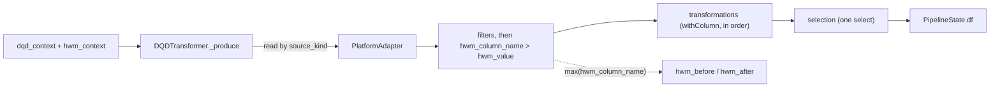

# Design — Declarative Query Definition

**Audience:** public
**Status:** accepted by the owner, 2026-09-29
**Date:** 2026-09-29
**Depends on:** F127 in `.claude/backlog.md`: the staged `scdDeletedFlag` becomes optional
**Tracked as:** F137, F138, F139, F140

## Overview

A Declarative Query Definition (DQD) brings one source entity to the load with light, per-row
changes and no code: read one Delta table, parquet location, catalog view or Fabric Warehouse
view, filter its rows, derive and rename columns, and hand the result to the SCD pipeline. It is
a new source step, `DQDTransformer`, on a new, small expression library, and is configured
by a `dqd_context` section of the load context. A new `hwm_context` section holds the load's
watermark, which both DQD and staging-notebook loads read. The DQD does not use or import
`fabric_dqf.py`, and it does not replace it: joins, aggregation, lookups and the rest stay with
DQF.

The owner's decisions, 2026-09-29:

1. The name is Declarative Query Definition (DQD). The alternatives offered were Source Mapping,
   Table Projection, Column Mapping Definition and Load Shape Definition.
2. The DQD is a brand-new, self-sufficient transformer on a new lightweight library. It does not
   use `fabric_dqf.py`, not even its resolver.
3. It carries over DQF's filtering, transformation and selection, with function resolution. There
   is one source entity, with no joins, aggregation, sorting or deduplication.
4. Filtering stays as DQF implements it: a list of predicates, AND-ed, with the same operators.
5. The source kinds are Delta, parquet, a catalog view and a Fabric Warehouse view.
6. The JSON follows the load context's naming: snake_case keys, with a `_column` or `_path` suffix
   where the main context uses one.
7. The watermark moves into its own `hwm_context` section, with two keys for now:
   `hwm_column_name` and `hwm_value`. DQD and staging-notebook loads read it. DQF keeps its
   `hwmColumnName` and `hwmCurrentValue` until its refactor (F74).
8. F127 lands first, so a DQD definition need not produce `scdDeletedFlag`.
9. A staging function receives `hwm_context` as a fifth, optional parameter, detected from the
   function's signature, so a four-parameter function keeps working unchanged.
10. `DQDTransformer` implements the `HWMProvider` protocol from `hwm_context`.
11. Every SCD-managed column is reached through the column map the context defines, never by a
    literal name.
12. Transformations behave as in `fabric_dqf.py`, and the code is built to be easier to manage
    than it: small units, parsed once, one place per expression kind.

## Goals

- Load a single entity into the SCD pipeline from a JSON definition alone, without writing a
  staging notebook.
- Keep DQF's expression power for per-row work: column references, literals, casts, the
  allow-listed functions of `pyspark.sql.functions`, `when`, arithmetic and comparison operators,
  and predicates.
- Give every source kind the same filter, transformation and selection rules.
- One watermark, in one place, for DQD and staging-notebook loads. It filters the source and is
  reported as the load's `hwm_value_before` and `hwm_value_after`.
- Work unchanged as a wheel and as a copy of `src/`, on every platform. The Fabric Warehouse view
  refuses clearly where it cannot work.

## Non-goals

- Joins, unions or more than one source.
- Aggregation, `group by`, `having`, `distinct` or deduplication, sorting, window functions,
  `limit` or `repartition`.
- DQF's `lookup`, `extract_objects`, `masking` and `validation`.
- Raw SQL: no `sql` source kind, and no function that runs a string as SQL (`expr`).
- User-defined functions.
- Changing, wrapping or deprecating DQF. A later DQF refactor may adopt the DQD's library; that is
  F74's decision.
- Storing the watermark. The caller keeps `hwm_value_after` and passes it to the next run, as
  today.

## Proposed API

### The load-context sections

```json
{
  "dqd_context": {
    "source_kind": "delta",
    "source_identifier": "bronze.crm.customers",
    "source_columns": ["CUST_ID", "FIRST", "LAST", "DOB", "STATUS", "MODIFIED_AT"],
    "filters": [
      {"operator": "=", "left": {"column": "STATUS"}, "right": {"literal": "active"}}
    ],
    "transformations": [
      {"name": "full_name", "expression": {"function": "concat_ws", "arguments": [
        {"literal": " "}, {"column": "FIRST"}, {"column": "LAST"}]}}
    ],
    "selection": [
      {"name": "customer_id", "expression": {"column": "CUST_ID"}},
      {"name": "full_name"},
      {"name": "birth_date", "expression": {"cast": {"expression": {"column": "DOB"}, "data_type": "date"}}},
      {"name": "modified_at", "expression": {"column": "MODIFIED_AT"}}
    ]
  },
  "hwm_context": {
    "hwm_column_name": "MODIFIED_AT",
    "hwm_value": "2026-09-01 00:00:00"
  }
}
```

`dqd_context`:

| Key | Required | Meaning |
|---|---|---|
| `source_kind` | yes | `delta`, `parquet`, `view` (a catalog view) or `warehouse_view` (a Fabric Warehouse or SQL-endpoint view). |
| `source_identifier` | yes | A Unity Catalog or metastore name, or a path for `delta` and `parquet`. For `warehouse_view`, the three-part warehouse name. |
| `source_columns` | no | The columns to read, before anything else. DQF's `columns`. |
| `filters` | no | Predicates, AND-ed, applied to the source columns. DQF's `filter` and `filter_condition`. |
| `transformations` | no | Named expressions added in order; a later one may use an earlier one. DQF's `transform`. |
| `selection` | no | The output columns, in order. An entry with only `name` selects that column. Without `selection`, every source column and every transformation passes through. DQF's `select`. |
| `warehouse_workspace_id`, `warehouse_id` | for `warehouse_view` only | Where the warehouse is, where the platform needs it. DQF's `defaultWorkspaceId` and `defaultLakehouseId`. |

*Amended 2026-09-29 by F140: the two keys are `workspace_id` and `lakehouse_id`, named for what the
code sends: DQF's proven call passes `defaultLakehouseId` as the connector's `lakehouseId`, a
lakehouse SQL endpoint. Whether a Warehouse item needs another connector option is not known
without a live Fabric run, so no key promises it; renaming later would be a context-field rename
(CLAUDE.md §3). Both keys stay optional: the connector defaults to the notebook's own workspace.*

`hwm_context`:

| Key | Required | Meaning |
|---|---|---|
| `hwm_column_name` | yes | The source column that grows with every change. |
| `hwm_value` | no | The previous run's watermark. Without it, the first run reads everything. |

These two are the whole section for now (owner, 2026-09-29); another key is refused until it is
added deliberately.

### Expressions and predicates

DQF's grammar, with its keys renamed to the context's style. Nothing else changes: the same
kinds, the same resolution and the same argument handling.

*Amended 2026-09-29 by F137: the library is stricter than DQF in six places, on purpose.*
*There is no `{"expr": ...}` wrapper node. A node with two kinds is refused, where DQF picks one.*
*`null_safe` is accepted on `=` only. `like` and `starts_with` take a literal string only.*
*`in` against a single literal is refused when parsed, where DQF fails at Spark analysis. `substr`
takes its position and length as literal columns, because DQF's raw values fail on PySpark 3.5
(F141). Column names are resolved against the source's columns as Spark does: case-insensitively
unless the session is case-sensitive, refusing a name two columns share but for case. The hidden
`_metadata` column is left to Spark. `approx_percentile` joined the refused functions, and a test
holds the refused set against Spark's own registry.*

| DQF | DQD | Note |
|---|---|---|
| `{"col": "x"}` | `{"column": "x"}` | A dotted name reads a struct field. There is no table prefix, because there is one source. |
| `{"lit": v}` | `{"literal": v}` | A list becomes an array. |
| `{"cast": {"expr": e, "dataType": t}}` | `{"cast": {"expression": e, "data_type": t}}` | |
| `{"fn": f, "args": [...]}` | `{"function": f, "arguments": [...]}` | Resolved against the allow-list below. |
| `fn: "when"` with 2 or 3 arguments | `function: "when"` with 2 or 3 arguments | Argument 0 is a predicate. |
| `fn` of `= == != > >= < <= + - * / %` | `function` of the same | |
| `{"op": o, "left": a, "right": b, "null_safe": true}` | `{"operator": o, "left": a, "right": b, "null_safe": true}` | `and`, `or`, `not`, `=`, `!=`, `>`, `>=`, `<`, `<=`, `in`, `like`, `starts_with`, `is_null`, `is_not_null`. `not` takes `expression`. |
| a transformation's `as`, a selection's `as` | `name` | |

**Function resolution** keeps DQF's rules:

- The allow-list is every public, callable name in `pyspark.sql.functions` whose module is
  `pyspark.sql`.
- Names that run arbitrary code or SQL are forbidden: `expr`, `udf`, `pandas_udf`, `call_udf`,
  `call_function`, `reflect`, `try_reflect`, `java_method`, `try_java_method`, `unwrap_udt` and
  `broadcast`.
- Aggregate, window, sort and generator functions are also refused, because they break the
  one-row-in, one-row-out promise. Examples are `sum`, `count`, `collect_list`, `row_number`,
  `rank`, `lag`, `asc`, `desc`, `explode`, `posexplode` and `inline`. The list is written out in
  the library and tested.
- A name is lower-cased and looked up. An unknown or refused name fails with a message that names
  it.
- An argument is a column unless the function takes a raw value in that position. The positions
  are DQF's `literal_arg_positions` table, carried over as is.

### Public names

| Name | Where | What |
|---|---|---|
| `DQDTransformer` | `orchestration/transformers/dqd.py`, exported from `orchestration` and `orchestration.transformers` | The source step. `DQDTransformer(dqd_definition=None)`, where `None` reads `dqd_context`. It reports the watermark through the `HWMProvider` protocol. |
| `DQDContext`, `HWMContext` | `orchestration/models.py` | The two new context classes, each with `validate()`. |
| `resolve_expression`, `resolve_predicate`, `resolve_function` | `orchestration/dqd/` | The library. It is pure: it takes a `DataFrame` or `Column`, never reads a source and never touches a platform. |
| `PlatformAdapter.read_warehouse_view` | `adapters/platform_adapter.py` | A new method; see below. |

## Internal design



- **The library, `orchestration/dqd/`**, depends only on PySpark and on nothing else in the
  package. It holds the expression and predicate resolvers, the allow-list and its refusals, and
  the raw-value argument table. It is below `transformers/` in the layers, like the pure-data layer.
  `DQDTransformer` reaches it the way transformers reach Delta, through a re-export seam, so
  `layering` rule 3 keeps holding.
- **Same behaviour as DQF, easier to manage (decision 12).** DQF resolves an expression in one
  function of branches over raw dicts, re-reading the JSON at every call. The library instead:
  - parses the definition once, at `validate()`, into small frozen dataclasses (a column, a
    literal, a cast, a function call, a predicate), so a malformed definition fails before any
    Spark work and resolution never sees raw JSON;
  - resolves each kind in its own small function, found through one table keyed by kind, so a new
    kind is one entry and one function, not a new branch in a long chain;
  - keeps the allow-list, its refusals and the raw-value positions as named module-level tables,
    each with its own test;
  - keeps DQF's results: each carried-over DQF case gives the same column for the same input,
    which is how the tests are written.
- **Reading.** Each `source_kind` goes through `PlatformAdapter`, so identifier routing stays in
  one place (`platform-boundary` rule 6):
  - `delta` uses the existing `read_delta`.
  - `parquet` uses a new `read_parquet`, whose default is the portable `spark.read.parquet`.
  - `view` uses a new `read_table` for a catalog name, whose default is `spark.table`.
  - `warehouse_view` uses a new `read_warehouse_view`, which is the one platform-specific
    method.
  - The new default methods follow `platform-boundary` rule 3. Each has a default, an override
    only where a platform needs one, and a recording stub on `MockPlatformAdapter`.
*Amended 2026-09-29 by F139: the expressions are parsed by `DQDTransformer`, before it reads the
source, not at `validate()`: `models.py` is pure data and may not import the library (layering
§7). A malformed expression therefore arrives as a `run()` error result, and under `set_source`
only when the DQD branch is chosen. `validate()` checks the section's shape. The watermark's
`hwm_value` is cast to the column's type (open question 1, closed), a DQD with `hwm_context`
refuses `load_type` `Full`, and a load context with a `dqd_context` beside staging stages or a
DQF spec logs a warning.*

- **Order of work.** Read, then `source_columns`, then `filters`, then the watermark filter
  `hwm_column_name > hwm_value`, then `transformations` in order, then `selection` as one `select`. This
  is DQF's order without the steps left out. Filters and the watermark apply to source columns, as
  in DQF.
- **The watermark.**
  - `hwm_before` is `hwm_value`.
  - `hwm_after` is `max(hwm_column_name)` over the filtered source, formatted by Spark with
    `.cast("string")` in the session time zone, as F88 measured.
  - It is one aggregation: a Spark action, said so in the docstring (`spark-delta-cost` rule 3).
  - With no rows, `hwm_after` stays `hwm_before`.
  - The step declares all three `HWMProvider` attributes, and sets them only inside `_produce`.
- **Staging loads.**
  - `build_staging_phase_context` adds `hwm_context` to each notebook's argument, so a staging
    function can filter by it.
  - `StagingTransformer` becomes an `HWMProvider` when `hwm_context` is set, reporting
    `max(hwm_column_name)` over the staged rows the same way. That replaces the hand-written step in
    the [incremental-loads guide](../../guides/run-incremental-loads.md).
  - A staging function receives it as a fifth parameter, `hwm_context`, only when its signature
    declares one; `create_staging_main_function` inspects the signature once, when it wraps the
    function. A function with four parameters is called as today.
- **Contracts kept.**
  - `DQDTransformer` is a `SourceTransformer` at position 0 that implements `_produce` only.
  - Its services are injected at `.run()`.
  - It adds no routing column and no frame key (`data-contract`).
  - **Every SCD-managed column goes through the context's column map (decision 11).** The
    business key, source system, deleted flag and the other SCD columns are named by the
    `scd_context` fields that `ColumnNamingPolicy` resolves, never by a literal such as
    `scdDeletedFlag` or `scdSourceSystem`. The library knows no SCD column at all; the
    transformer reads each name from the context when it needs one. A test renames every SCD
    column in the context and runs a DQD load end to end.
  - With F127 landed, the source check no longer requires `scdDeletedFlag`, so a definition that
    leaves it out loads as not deleted.
- **Context parsing.** `LoadContextManager.parse` reads the two new sections, and `validate_all`
  validates each one present. Both are optional: a load without them behaves exactly as today.
  `LoadContext` gains two optional fields, so a transformer reads them the typed way, not from
  `_ctx_manager`.

## Platform-specific behavior

- `delta`, `parquet` and `view` are portable. They behave the same on Fabric, Databricks
  (classic and serverless) and locally.
- `warehouse_view` needs the new `PlatformAdapter.read_warehouse_view(spark, identifier, *,
  workspace_id=None, warehouse_id=None)`:
  - `FabricAdapter` overrides it with the Fabric Warehouse connector. How that call is made is the
    implementation's business, not this design's.
  - The default, which `DatabricksAdapter` and `LocalAdapter` inherit, raises
    `NotImplementedError`. The message says a warehouse view is a Fabric source, and to use
    `view` for a catalog view.
  - `MockPlatformAdapter` records the call.
  - This is on the CLAUDE.md §3 floor: it cannot be proven here. None of the four runtime
    combinations runs in this repository, so a live Fabric check is owed before it is called
    done.
- **Not a new leak.** DQF's `view` kind calls `synapsesql` outside any adapter (CLAUDE.md §9).
  The DQD reaches the same capability only through the adapter.

## Error handling

- **At `validate()`, before any Spark work:**
  - an unknown `source_kind`;
  - a missing `source_identifier`;
  - `warehouse_view` without the fields the platform needs;
  - a transformation or selection entry without `name`;
  - a duplicate `name`;
  - an expression or predicate whose shape is not in the grammar;
  - an unknown key, anywhere in `dqd_context` or `hwm_context`. The load context ignores an unknown
    top-level section today; an unknown key inside these two is refused, so a DQF-style `expr` or
    `hwmColumnName` fails loudly instead of being dropped.
- **At resolution:**
  - an unknown or refused function names itself and the entry it is in;
  - a column the source does not have names the column and the entry;
  - a missing `hwm_column_name` is refused before the filter.
- `run()` still returns these as an error result and does not raise, as today.

## Testing strategy

- **Unit, the library.** Written from a table of DQF cases carried over, one expression kind and
  predicate operator per test:
  - every function refusal;
  - every raw-value argument position;
  - `when` with 2 and 3 arguments;
  - a later transformation reading an earlier one.
- **Unit, `DQDTransformer`.** With a real Spark session, one per source kind:
  - `delta` and `parquet` on local files;
  - `view` on a temporary view;
  - `warehouse_view` against `MockPlatformAdapter`, for the call and its arguments, and against
    `LocalAdapter`, for the refusal.
  - The watermark on the first run, on a later run, and with no new rows.
- **Unit, context.** `DQDContext.validate` and `HWMContext.validate` accept the documented shapes
  and refuse each malformed one.
- **Integration.** A load through `DQDTransformer`, the detector and the merge writer, run twice,
  with the second run filtered by the first run's `hwm_value_after`. The same for a staging load
  reading `hwm_context`.
- **Architecture.** The library imports nothing from `spark_quick_start` and nothing but PySpark
  (`layering`, `dual-shipping`); `DQDTransformer` reaches it only through its seam; the new
  adapter methods follow `platform-boundary`. The new sections are covered by the existing
  load-context reference test, and by the F65 example check where a guide shows a definition.
- **Not provable here:** `read_warehouse_view` on Fabric, and serverless behaviour on either
  platform. Both are said to be unproven when F140 lands.

## Documentation plan

- **Reference.**
  - `docs/reference/load-context.md` gains the `dqd_context` and `hwm_context` sections. The
    reference test fails without them.
  - `docs/reference/transformers.md` gains `DQDTransformer`.
  - `docs/reference/platform-adapters.md` gains the three new methods.
  - A new `docs/reference/dqd-definition.md` lists every expression kind, predicate operator,
    refused function and raw-value position, with the DQF key it replaces.
- **Guides.**
  - A new guide, "Load a table with a DQD", written to `writing-guides`.
  - The [incremental-loads guide](../../guides/run-incremental-loads.md) is rewritten around
    `hwm_context`.
- **Architecture.** `metrics-and-watermarks.md` changes: the watermark now has a home in the
  context, and `StagingTransformer` is a provider when it is set.
- **Rules.** `layering` gains a rule for the library, like rule 5 for `fabric_dqf.py`, and its
  architecture test.

## Delivery

In order, each a `/fix` in `.claude/backlog.md`:

1. **F137, the library** (`orchestration/dqd/`). Pure, with its unit tests and the `layering`
   rule. No context change and no transformer.
2. **F138, `hwm_context`.** The section, its validation and reference, the staging argument, and
   `StagingTransformer` as a provider. This one is the staging half of decision 7.
3. **F139, `DQDTransformer`** for `delta`, `parquet` and `view`, with `dqd_context`,
   `read_parquet` and `read_table`, the reference pages and the guide. It depends on F127, F137
   and F138.
4. **F140, `warehouse_view`**: `PlatformAdapter.read_warehouse_view`, the Fabric override and the
   refusals. It is on the §3 floor, in plan mode, with a live Fabric check owed.

## Open questions

1. **Is `hwm_value` compared as a string, or cast to the column's type?** DQF compares
   `col > lit(value)` and lets Spark coerce. The DQD keeps that, unless the owner wants an explicit
   cast; F88 showed the time-zone trap on the reporting side.
2. **Does selection-less output pass through everything?** DQF does. The proposal keeps it, so a
   definition with only `source_*` and `filters` is valid.
