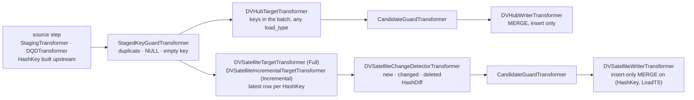

# Design — Data Vault targets: hub and satellite

**Audience:** public
**Status:** accepted by the owner, 2026-10-01
**Date:** 2026-10-01
**Tracked as:** F156, F157, F158, F159, F160, F161, F162; after F155, F134 and F154
**Depends on:** F155 in `.claude/backlog.md` (the SCD-specific steps gain an `SCD` prefix first);
F134 and F154 (the staged-key guard, which the Data Vault factories compose);
[the key-identity exploration](2026-10-01-key-identity-exploration.md) and
[the SCD-version exploration](2026-10-01-scd-version-ownership-exploration.md), whose
questions this record answers for one more target style.

## Overview

A Data Vault target is a second persistence style beside SCD: insert-only tables keyed by a hash
of the business key, loaded from the same staged frame the SCD pipeline uses. This record covers
the first increment, a **hub** (one row per business key, ever) and a **satellite** (one row per
change to the key's descriptive attributes, per source system). A **link** is reserved and not
built. The style is chosen in the load context's existing `scd_context`, so no pipeline that runs
today changes; the Data Vault steps are new transformers composed into two new pipeline factories;
nothing in the SCD steps moves.

The owner's decisions, 2026-10-01, from a brainstorm whose critical review is kept in this record:

1. Data Vault support is a selling feature of the library, not a door left open.
2. The first increment is a hub and a satellite for one entity. The link comes next; its style
   value exists from the start and is refused until built.

   *Amended 2026-10-01 by [the Data Vault link design](2026-10-01-data-vault-link-design.md): the link is designed there, F167 and F168 build it.*
3. **One run, one target.** A hub and a satellite are two runs with two load contexts over the
   same source. A fan-out run over several targets is a later design, because it changes
   `ExecutionResult`.
4. **One `scd_context`**, extended with optional keys whose absence means today's behaviour, so
   no existing pipeline breaks. A separate `dv_context` and an umbrella `target_context` were
   considered and rejected (see Rejected).
5. **The hash key is built upstream**, in the staging notebook or the DQD, exactly as `scdRowKey`
   is today (F148, case 1): the staged frame carries it under `business_key_column`, and
   `row_key_column` names it in the target. The library does not build it.
6. **The hash diff is computed by the library**, as `scdHash` is, over every column but the key,
   the meta columns and `exclude_from_hash`, with `hash_algorithm` `sha256` by default or `md5`,
   hex, lower case.
7. **Hub keys carry no source system.** A hub integrates an entity across sources; a satellite
   belongs to one source. Several sources mean several satellites on one hub, composed by the
   owner of the pipeline, never one satellite with a source in its key.
8. **A separate `DVSatelliteChangeDetectorTransformer`.** The SCD detector is not generalised and
   is not touched; the two share the hashing helper only.
9. **Canonical Data Vault 2.0: insert-only, everywhere.** No row in a hub, a link or a
   satellite is ever updated or deleted by the library; a change, a delete and a reappearance
   are each a new satellite row. So no end-dating, no current flag, no version. `LoadEndTS` is
   an audit stamp of the load, not a lifecycle end: `LoadTS` is the run's start and `LoadEndTS`
   the moment the writer starts writing, both known before the insert. An **`IsCurrent`
   feature** is foreseen as a later increment, and this design leaves room for it: it would be
   a step after the writer, maintaining a current-row marker (a flag column, or a current-rows
   view or point-in-time table) over the insert-only satellite, never a change to what the
   writer inserts. The insert-only writer is the invariant; `IsCurrent` is derived from it.

   *Amended 2026-10-03 by F106: `LoadTS` is `global_context.load_timestamp`, the run's load time,
   not the run's start (the owner's decision); `LoadContext.run_started_at` is removed.
   `LoadEndTS` stays the clock at stamping, so with a backfilled load time it is not a duration
   after `LoadTS`. The satellite writer refuses a load time not after its newest `LoadTS`, one
   added aggregation; the hub and the link take any load time.*

   *Amended 2026-10-04 by F106: the backfill refusal was removed on the owner's decision; an earlier or equal LoadTS is the user's responsibility.*

10. The SCD-specific steps gain an `SCD` prefix before any Data Vault step lands (F155), so the
    two styles are named alike.
11. **Row identity differs by style, deliberately.** SCD tells entities apart by business key and
    source system; Data Vault integrates them by business key alone. Neither model is to be
    forced on the other.

## Goals

- Load a hub and a satellite from any source step the library has (`StagingTransformer`,
  `DQDTransformer`), with the guards, materialisation, debug and metrics steps it has, unchanged.
- Produce tables that Data Vault practitioners recognise: a hash key in hex, a hash diff, a load
  timestamp, a record source, insert-only.
- Keep every existing load context valid and every existing table's behaviour unchanged.
- Refuse, loudly and before any write, the configurations that corrupt a vault silently: a hash
  diff computed with different settings on one table, a NULL or empty key part, a key staged
  twice in one batch, a Data Vault step in an SCD pipeline or the reverse.
- Work unchanged as a wheel and as a copy of `src/`, on every platform.

## Non-goals

- Links, point-in-time and bridge tables, multi-active and effectivity satellites, status-tracking
  satellites, the business vault. The style value `dv_link` is reserved; nothing else is.

*Amended 2026-10-01 by [the Data Vault link design](2026-10-01-data-vault-link-design.md): links leave this list; the rest stays.*
- One run writing several targets. See decision 3.
- End-dating a satellite row (`LoadEndTS` as a lifecycle end), and an `IsCurrent` marker. Both
  are foreseen as later increments (decision 9): a step after the write, over the insert-only
  satellite, never a change to the writer. Nothing in this record is to make that step harder.
- Building the hash key in the library (F149 stays an idea).
- Any interoperability between SCD targets and Data Vault targets: `scdRowKey` is readable,
  `HashKey` is a hash, and no join between the two is promised.
- Changing the SCD detector, the SCD writers, the MERGE or the SCD column names.

## Proposed API

### `scd_context`, extended

Every key below is optional on an SCD load context. Absent, nothing changes.

| Key | Values | Meaning |
|---|---|---|
| `scd_type` | `scd1`, `scd2`, **`dv_hub`, `dv_satellite`, `dv_link`** | The style. `dv_link` is refused with "not yet supported" until built. The name of the key is an admitted wart, kept for compatibility: a second selector could contradict it. |
| `hash_algorithm` | `sha256` (default), `md5` | The hash diff's algorithm, Data Vault styles only. Hex, lower case, via `pyspark.sql.functions.sha2` or `md5`. |
| `load_ts_column` | name, default `LoadTS` | The load timestamp column, Data Vault styles only. |
| `load_end_ts_column` | name, default `LoadEndTS` | The load's end-of-preparation stamp, Data Vault styles only. |
| `batch_id_column`, `pipeline_run_id_column` | names, no default | Audit columns written when named; any style. From `runtime_context` (`pipeline_run_id` is a new optional key there; `batch_id` is the run's correlation id until a batch concept exists). |

*Amended 2026-10-01 by F156: `batch_id_column` is not added. Nothing supplies a batch id other than the run's correlation id, which `correlation_id_column` already writes; a batch concept comes first. `pipeline_run_id_column` is accepted under the Data Vault styles only, for now: writing it from the SCD writers would change their output, which is not this increment's.*

Keys the styles share, with **style-dependent defaults** (the owner's comparison table of
2026-10-01, one policy, not two):

| Key | SCD default | Data Vault default | Role |
|---|---|---|---|
| `business_key_column` | required | required: the staged `HashKey` | decision driver: what the target is matched on |
| `row_key_column` | `scdRowKey` | `HashKey` | the key's name in the target; same as the business key under case 1 |
| `hash_column` | `scdHash` | `HashDiff` | decision driver: has the row changed |
| `deleted_flag_column` | `scdDeletedFlag` | `IsDeleted` | decision driver |
| `source_system_column` | `scdSourceSystem` | `RecordSource` | SCD: part of the identity; Data Vault: an attribute |
| `correlation_id_column` | `scdCorrelationId` | `CorrelationId` | audit |
| `hash_separator` | `~` | `\|\|` | the hash diff's separator |
| `exclude_from_hash` | `[]` | `[]` | columns left out of the hash diff |
| `version_column`, `current_flag_column`, `effective_from_column`, `effective_to_column` | SCD names | not written | SCD only; a Data Vault style ignores them and says so at validation |
| `scd_row_hashing` | `false` | refused | the key is built upstream |
| `load_type` | `Incremental` | `Incremental` | `Full` also classifies absent keys as deleted: in SCD, and in a satellite. A hub (and a link) never deletes, so `load_type` has no effect there; accepted, not refused, because one load context is often shared between a hub run and a satellite run. |

A Data Vault load context that sets an SCD-only key, or an SCD one that sets a Data Vault-only
key, is refused at `validate_all` naming the key and the style, never silently ignored.

### Two load contexts for one entity

The hub:

```json
{
  "global_context": {"entity_name": "Customer", "source_system": "CRM",
                     "target_table_path": "silver.vault.customer_h", "staging_table_path": "..."},
  "scd_context": {"scd_type": "dv_hub", "business_key_column": "HashKey"},
  "dqd_context": {
    "source_kind": "delta", "source_identifier": "bronze.crm.customers",
    "transformations": [
      {"name": "HashKey", "expression": {"function": "sha2", "arguments": [
        {"function": "concat_ws", "arguments": [{"literal": "||"},
          {"function": "upper", "arguments": [{"function": "trim", "arguments": [
            {"function": "coalesce", "arguments": [{"cast": {"expression": {"column": "CUST_ID"}, "data_type": "string"}}, {"literal": ""}]}]}]}]},
        {"literal": 256}]}}
    ],
    "selection": [{"name": "HashKey"}, {"name": "CustomerNo", "expression": {"column": "CUST_ID"}}]
  }
}
```

The satellite, same source, same key expression, the descriptive columns selected:

```json
{
  "global_context": {"entity_name": "Customer", "source_system": "CRM",
                     "target_table_path": "silver.vault.customer_crm_s", "staging_table_path": "..."},
  "scd_context": {"scd_type": "dv_satellite", "business_key_column": "HashKey",
                  "source_deleted_flag_column": "IsDeleted", "exclude_from_hash": ["LoadedBy"]},
  "hwm_context": {"hwm_column_name": "MODIFIED_AT", "hwm_value": "2026-09-01 00:00:00"},
  "dqd_context": {"...": "the same HashKey transformation, then the descriptive columns"}
}
```

The key expression is copied between the two contexts. That it is the same expression is the
pipeline author's responsibility, as it is today for `scdRowKey` across staging phases; the guide
gives one canonical expression and the reference notebook uses it. The hub stores the business
key columns beside the hash so a reader can check.

### Public names

| Name | Where | What |
|---|---|---|
| `DVHubTargetTransformer` | `transformers/dv_hub.py` | Reads the hub's keys **that the staged batch carries** into `state.frames["target"]`, a semi-join whatever the `load_type`: a hub never deletes, so an absent key means nothing and the whole hub is never read. `None` when the table does not exist. |
| `DVHubWriterTransformer` | `transformers/dv_hub.py` | Inserts the keys the hub lacks: a MERGE with `whenNotMatchedInsert` only, so two sources loading one hub at once cannot duplicate a key. `RecordSource` is the source that saw the key first. Reports `inserted`; `updated` is structurally 0. |
| `PlatformAdapter.get_table_properties`, `set_table_properties` | `adapters/platform_adapter.py` | Two new methods with a portable default each; see Platform-specific behavior. |
| `DVSatelliteTargetTransformer` | `transformers/dv_satellite.py` | Reads the latest row per `HashKey` over the **whole** satellite into `state.frames["target"]`: the step for a `Full` load, where keys absent from the source must be found. |
| `DVSatelliteIncrementalTargetTransformer` | `transformers/dv_satellite.py` | The same, over the keys the staged batch carries only, after a semi-join; refuses a `Full` load, as `SCDIncrementalTargetTableTransformer` does. The two mirror the SCD pair: the step is chosen, not switched by a flag. |
| `DVSatelliteChangeDetectorTransformer` | `transformers/dv_satellite.py` | Classifies staged rows as `new`, `changed` or `deleted` against that frame and computes the hash diff. Writes `_change_type` from `_constants.py`, the same routing column the SCD detector writes, so `CandidateGuardTransformer` serves both. |
| `DVSatelliteWriterTransformer` | `transformers/dv_satellite.py` | Stamps `LoadTS`, `LoadEndTS`, `RecordSource`, `IsDeleted`, the audit columns, and writes an insert-only MERGE on `(HashKey, LoadTS)`, so two concurrent runs on one satellite conflict and retry rather than both appending. Reports `inserted`. The watermark stays the source step's, as today. |
| `StagedKeyGuardTransformer` | `transformers/staged_key_guard.py` (F134, F154) | Refuses a staged key present twice, NULL or empty. Composed by both Data Vault factories, not optional there: a satellite batch shares one `LoadTS`, so a duplicate key is a primary-key collision Delta will not report. |
| `dv_hub_pipeline`, `dv_satellite_pipeline` | `orchestration/pipeline_factory.py` | The compositions: source, `StagedKeyGuardTransformer`, target, detector (satellite only), `CandidateGuardTransformer`, writer. |
| `SCDContext.style` properties | `orchestration/models.py` | `is_data_vault`, and the style-dependent defaults. |
| `hash_hex` | the hashing helper beside the SCD hash | `sha2(..., 256)` or `md5` over `concat_ws(separator, coalesce(cast(c, string), null_token)...)`, shared by the satellite detector; the SCD detector keeps `xxhash64`. |

*Amended 2026-10-01 by F159: `dv_hub_pipeline` composes no `CandidateGuardTransformer`. It groups on the business key and the source system column, which a hub's staged rows do not carry (the source system is stamped by the writer), so it fails there; and the staged-key guard already refuses a key staged twice. `LoadTS` reaches the writer as `LoadContext.run_started_at`, which `LoadOrchestrator` sets. The writer reports its run's `LoadTS` as `hwm_after` and no `hwm_before`, so the orchestrator's harvest, which counts a writer as run only when `hwm_after` is set, takes its counts. The DQD gained `sha2`'s bit length as a raw argument, which the canonical hash key needs.*

*Amended 2026-10-03 by F106: `LoadContext.run_started_at` is removed; `LoadTS` reaches the writers as `global_context.load_timestamp`, read through `GlobalContext.load_timestamp_utc`.*

*Amended 2026-10-03 by F117: the harvest no longer counts a writer as run by `hwm_after`. The proof is `inserted` and `updated` both not `None`, which a writer declares `None` in `__init__` and sets in `_run`; the post-write watermark read can fail and be swallowed while the counts are real. `hwm_after` now selects the watermark source only.*

*Amended 2026-10-01 by F162: `dv_satellite_pipeline` composes no `CandidateGuardTransformer` either, as the hub (F159): it is SCD-only since F156, and with one staged row and one latest row per key the detector cannot emit a key twice. That precondition holds because `StagedKeyGuardTransformer` keys on the business key alone under a Data Vault style, `source_system_from_source` or not; it keyed on the source system too, which let one key from two sources reach both writers twice (F162's review). The satellite writer's MERGE is not retried: a DataFrame over a Delta table keeps the snapshot it was defined on (measured locally), so a retry would re-run the detector's rows on the old satellite and insert a change the winning load had written; the conflict fails the load and its rerun re-detects. The hub's MERGE keeps its retry, its predicate being the key checked against the table as it then is. Clustering on `HashKey` at creation is not done: `write_delta_create` takes no clustering option, and adding one is an adapter question; tracked as F166.*

Every name is exported from `orchestration` and `orchestration.transformers` beside the SCD ones.

## Internal design



Read it as two pipelines sharing everything up to the target step; a run composes one of them.

**The hub.** The target frame is the hub's key column (and `RecordSource`) for the keys the
batch carries, by a semi-join against the staged keys whatever the `load_type` (the owner,
2026-10-01): a hub never deletes, so a key absent from the batch means nothing, and the hub is
never scanned as a whole. The writer anti-joins
the staged keys against it to count, then MERGEs on `tgt.HashKey = src.HashKey` with
`whenNotMatchedInsert` only, through `run_with_delta_retry`: a concurrent hub load from another
source conflicts and retries rather than duplicating. A hub row is never updated or deleted; a
source delete does not reach the hub. Columns: `HashKey`, the business key columns as staged,
`LoadTS`, `LoadEndTS`, `RecordSource`, the audit columns.

**The satellite target frame** is the latest row per `HashKey`:
`groupBy(HashKey).agg(max(struct(LoadTS, HashDiff, IsDeleted)))`, one aggregation with map-side
partial aggregation and no join back; a window `row_number` would sort every row, and
`max(LoadTS)` plus a join back scans twice and duplicates on ties (the Delta specialist,
2026-10-01). Two steps carry it, mirroring the SCD pair (the owner, 2026-10-01):
`DVSatelliteIncrementalTargetTransformer` semi-joins the satellite to the staged keys first, so
only the batch's keys are aggregated and the cost follows the batch; `DVSatelliteTargetTransformer`
aggregates the whole satellite, which a `Full` load needs to find the keys absent from the
source, and its cost follows the history, where the SCD target reads current rows by a flag.
Each step's docstring says its cost (`spark-delta-cost`); the incremental one refuses `Full`. The writer declares clustering on `HashKey` at creation so the semi-join
can skip files; whether skipping happens on either platform is a live check. A maintained
"latest per key" helper table costs a second, non-atomic commit per load and is not built now:
measure a `Full` load's scan first.

*Amended 2026-10-04 by F166: the writers do not declare clustering at creation. `write_delta_create`
takes no clustering option, and a new adapter capability for it was not taken. The library creates
Data Vault tables without clustering; the guide "Load a Data Vault entity" shows how to add it to
the table afterwards, as guidance: whether file skipping then happens is unverified here.*

**Satellite change detection**, against the latest row:

| Staged row | Latest satellite row | Result |
|---|---|---|
| key absent from the satellite | — | `new`: one row, `IsDeleted = N` |
| present, hash diff differs | not deleted | `changed`: one row |
| present, hash diff equal | not deleted | nothing |
| source signals deleted | not deleted | `deleted`: one row, `IsDeleted = Y`, the staged attributes |
| source signals deleted | deleted | nothing: the satellite already says so (the SCD detector re-deletes every load, F142; this detector does not, and F142's resolution for SCD is separate) |
| present, not deleted in the source | deleted | `changed`: one row, `IsDeleted = N`, whatever the hash diff |
| absent from the source, `Full` load | not deleted | `deleted`: one row from the latest satellite row |

*Amended 2026-10-03 by F142: the SCD detector now skips a delete whose target current row is already deleted, in both the source-flag and the Full paths.*

So the comparison is on the pair (hash diff, deleted flag), compared null-safely, with
`IsDeleted` kept out of the hash diff's input. A `deleted` row carries the latest descriptive
columns and hash diff forward, so a key that reappears unchanged is seen only by `IsDeleted`
flipping; a delete row written with blank attributes would break that, and a test pins the
carry-forward. A source delete signal for a key the satellite does not have is dropped, as the
SCD detector drops it. Confirmed by the Delta specialist, 2026-10-01, who also noted that the
SCD detector's two delete paths never check whether the target is already deleted (F142) and
are not to be copied.

*Amended 2026-10-03 by F142: the SCD detector now skips a delete whose target current row is already deleted, in both the source-flag and the Full paths.*

*Amended 2026-10-01 by F161: the table's "the staged attributes" for a source delete contradicted the paragraph above and the backlog; both delete paths carry the latest row's attributes and hash diff forward, since a CDC delete row is often blank. The detector asks no action of the target: an empty frame joins to nothing, so every live row is `new`. A `Full` load of an empty source over live keys is refused, as the SCD detector refuses it.*

**The hash diff** is the shared helper over the staged descriptive columns in alphabetical
order, NULL as the SCD null token, then `sha2(…, 256)` or `md5`, as `hash_algorithm` says.
Alphabetical order is deterministic for a given column set; a new source column changes every
row's diff, as it does `scdHash` today, and `exclude_from_hash` is the control. A Data Vault
variant of the Graceful detector's trailing-NULL trimming is not in this increment.

**Sealing the hash settings on the table.** The first write to a satellite records
`hash_algorithm`, `hash_separator` and the null token on the table as Delta table properties
(`spark_quick_start.hash_algorithm` and so on), and every later write compares its own settings
with the recorded ones and refuses a difference: a satellite whose diff was computed two ways
reports changes that did not happen, silently. The hub records the algorithm too, as
documentation of what the key was expected to be built with; it cannot verify a key it did not
build. Sealing is check-then-act, and the seal is a commit of its own after the data write, so:
only a missing or empty table counts as a first write; a populated table with no seal is refused,
not sealed late; and two first writers racing leave the last seal standing, which the refusal of
an unsealed populated table turns into a loud failure for the loser's next run (the architect,
2026-10-01).

**Timestamps.** `LoadTS` is `ExecutionResult.start_time`, UTC, the same for every row the run
writes; `LoadEndTS` is the writer's own clock when it starts writing, UTC. Both are `F.lit` of
timezone-aware datetimes, as the SCD writers do (`spark-delta-cost` 6). A re-run of a failed
batch gets a new `LoadTS`; it is safe because the first attempt's write was one atomic commit,
so either nothing landed or the re-run's detector sees equal hashes and writes nothing. What
that does not cover is two runs at once on one satellite: blind appends do not conflict, so the
writer is an insert-only MERGE on `(HashKey, LoadTS)` and `run_with_delta_retry` serialises
them.

*Amended 2026-10-03 by F106: `LoadTS` is `global_context.load_timestamp`, the run's load time (the
owner's decision), not `ExecutionResult.start_time`; it defaults to the instant the load context
is built, so a re-run that gives none still gets a new `LoadTS`, while one that gives the same
`load_timestamp` is refused by the satellite writer, which reads its newest `LoadTS` first and
raises when the load time is not after it.*

*Amended 2026-10-04 by F106: the backfill refusal was removed on the owner's decision; an earlier or equal LoadTS is the user's responsibility.*

**Metrics and the watermark.** The writers implement `SCDMetricsProvider` as the SCD writers do
(`inserted`, `updated = 0`); the protocol's name is a known debt, below. The watermark is the
source step's, through `hwm_context`, unchanged; the satellite run is the one that carries it.

**What stays shared, and why it can.** Within one run the source system is constant, so
`CandidateGuardTransformer`'s grouping on business key and source system is correct for a
satellite (`RecordSource` constant) and for a hub (the loading source constant). The guard reads
`ctx.scd_ctx` as before; nothing moves.

## Platform-specific behavior

- **Two new `PlatformAdapter` methods**, `get_table_properties(spark, identifier) ->
  dict[str, str]` and `set_table_properties(spark, identifier, properties)`, each with a portable
  default and no per-platform override (the architect, 2026-10-01). The defaults are SQL only,
  with no `DeltaTable` call, so they hold on Spark Connect and serverless where
  `resolve_delta_table` raises: `DESCRIBE DETAIL` for the read, `ALTER TABLE … SET TBLPROPERTIES`
  for the write, the target being `_quote_uc_name(identifier)` for a name or `` delta.`<path>` ``
  for a path through a new `_quote_delta_path` that refuses a backtick or control character
  (`spark-delta-cost` 5). Property keys are held to `spark_quick_start.<name>` and values to a
  closed set, since both go into DDL. Both are Spark actions on driver metadata, said in the
  docstrings. `MockPlatformAdapter` takes `table_properties` in its constructor and records
  `get_table_properties_calls` and `set_table_properties_calls`, the setter updating the dict so
  seal-then-refuse is unit-testable. Doing this in `load_pipeline.py` would move identifier
  routing out of `platform_adapter.py` (rule 6, the defect F6 removed), so it is an adapter
  method. A sidecar file beside a path table was rejected: it cannot exist for a catalog name, it
  is a file operation (rule 7) and it is outside the Delta transaction.
  *Amended 2026-10-01 by F157: values are held by a character denylist, not a closed set: no quote, backslash, backtick, `$` or control character, `$` because Spark substitutes `${…}` inside quoted literals and names before parsing (found by F157's check-adversary). A configured `hash_separator` holding one of these would load and then fail at sealing, so F158 refuses it up front in `SCDContext.validate`. A path keeps its backslashes and quotes, which are literal inside the backtick-quoted name.*
- Hash reproducibility outside Spark: `sha2`/`md5` hex of the same normalised string must equal
  what the SQL endpoint computes, so a consumer can rebuild a key. `upper` on non-ASCII text may
  differ between Spark and a binary UTF-8 collation. Not provable here; a live check on both
  platforms is owed before the guide calls the canonical expression reproducible.
- Clustering the satellite on `HashKey`: Z-ORDER on classic runtimes, liquid clustering where
  available. Table creation goes through the adapter's `write_delta_overwrite` today; a
  clustering option is a third adapter question, left to the implementation plan.
- Live checks owed, named by the architect: whether `ALTER TABLE` and `DESCRIBE DETAIL` on a
  `` delta.`<path>` `` target work on a Fabric lakehouse path, and whether Unity Catalog accepts
  custom non-`delta.*` property keys on serverless.

## Error handling

- `SCDContext.validate`: `dv_link` → "not yet supported"; a Data Vault style with an SCD-only key
  set, or `scd_row_hashing`, or an SCD style with a Data Vault-only key → `ValueError` naming
  the key and the style; `business_key_column` required in every style.
- `SCDChangeDetectorTransformer` and the `NativeSCD*` writers refuse a Data Vault style, and the
  Data Vault steps refuse an SCD style, at the start of `_run`, before any Spark action, naming
  the factory to use. A wrongly composed pipeline fails on its first step, not by writing SCD
  columns into a satellite.
  *Amended 2026-10-01 by F156: the refusal also happens when `LoadOrchestrator` assembles the pipeline, before the source runs staging, for every SCD step not inside `.add_if()`; the check at the start of `_run` stays for those, and runs after the template's `before_run`. No factory is named yet, because none exists before F159.*
- `StagedKeyGuardTransformer`: duplicate, NULL or empty key → `ValueError` with the count and
  samples (F134, F154), one aggregation, before classification: the satellite writer cannot
  reject a duplicate, and a `(HashKey, LoadTS)` collision is what a duplicate becomes.
- `DVSatelliteIncrementalTargetTransformer` under `Full` → `ValueError` naming
  `DVSatelliteTargetTransformer`, before any read.
- Sealed hash settings differ → `ValueError` quoting both sets, before the write.
- Everything else as the SCD steps: `ExecutionResult.status == "error"` with `error_details`,
  never an exception out of `run()`.

## Testing strategy

- **Unit**, real Spark, one step each: the context's style defaults and refusals
  (`test_orchestration_models.py`); the hub target and writer with a `MockPlatformAdapter`
  recording the MERGE; the satellite target's "latest per key" against a hand-built history; the
  detector against every row of the semantics table above, including the two deleted cases;
  the hash helper against known `sha256`/`md5` digests of fixed strings, both algorithms, NULL and
  separator handling; the staged-key guard's three refusals; the sealing check's refusal.
- **Integration**, local Delta (`tests/integration/local/`): a hub and a satellite loaded twice
  from one DQD source, a change, a delete, a reappearance, a second source system loading the
  same hub, a `Full` load deleting an absent key; asserting on the tables and on
  `ExecutionResult`. A duplicate staged key refused before any write. A satellite written with
  `sha256` refusing an `md5` run.
- **Architecture**: the transformer roster, the exported names, `_change_type` defined once and
  read by both detectors (the data-contract rule gains the second detector), the new factories
  in `test_pipeline_factory.py`, the reference pages against the code.
- Both platform-filtered suites.
- **Not provable here**: hash reproducibility on the Fabric and Databricks SQL endpoints,
  concurrent hub loads conflicting correctly on a live metastore, clustering taking effect.
  Listed as live checks owed, like F139 and F140.

## Documentation plan

- `docs/reference/load-context.md`: the new `scd_context` keys, the style-dependent defaults
  table, the refusals.
- `docs/reference/execution-result.md`: what `inserted` and `updated` mean for the two writers.
- `docs/reference/transformers.md`: seven new steps, not six, with the satellite's two target
  steps side by side as the SCD pair is.
- A new guide, `docs/guides/load-a-data-vault-entity.md`: hub then satellite, the canonical hash
  key expression, a second source as a second satellite, and the consumer's "current rows" query
  on each platform (`QUALIFY` on Databricks, a `ROW_NUMBER` subquery on Fabric).
- `docs/architecture/pipeline-model.md`: the second style and the identity sentence (decision 11).
- `.claude/rules/data-contract.md`: `_change_type` has two writers. CLAUDE.md's module map: the
  step count.
- A local reference notebook for one entity's hub and satellite.

*Amended 2026-10-01 by F162: the plan left out `README.md` and `docs/architecture/overview.md`, whose claims the feature made incomplete; both changed in PR #27, and a second local notebook loads the satellite step by step.*

## Risks and known debts, accepted with this design

- **Key specification drift between contexts** is the pipeline author's to prevent; the library
  verifies the diff's settings, not the key's. The guide's canonical expression is the control.
- **Two detectors** encode the classification twice. If a third style or a change to the
  semantics table makes them diverge, extracting a shared classifier is a refactor with two test
  suites behind it; that is when it is done, not before.
- **The consumer pays for insert-only**: "current rows" is a window per query, and Fabric T-SQL
  has no `QUALIFY`. The `IsCurrent` feature of decision 9 is the answer, as a later increment.
- **Key width**: 64 hex characters per `sha256` key, 32 for `md5`, against an 8-byte
  `xxhash64`. Join and storage cost on large satellites; `md5` is the trade.
- **The latest-per-key aggregation grows with the satellite**, see Internal design.
- **Names**: `scd_type: dv_hub`, `SCDContext` holding Data Vault settings, `SCDMetricsProvider`
  implemented by Data Vault writers. Each is a rename deferred, and a rename of a context key is
  CLAUDE.md §3.
- **`ColumnNamingPolicy` and `Constants`** gain style-dependent defaults; the deliberate
  duplication of `Constants` in `models.py` and `transformers/_constants.py` grows with them.
- **A backfill with an older `LoadTS`** breaks "latest is truest"; a Data Vault convention, not
  solved here.

  *Amended 2026-10-03 by F106: the satellite writer now refuses a load time not after its newest
  `LoadTS`, so a backfill into a satellite is refused rather than written. The hub and the link
  still take any load time. Backfilling a satellite remains unsolved.*

  *Amended 2026-10-04 by F106: the backfill refusal was removed on the owner's decision; an earlier or equal LoadTS is the user's responsibility.*

## Rejected

- **A separate `dv_context` section.** Clean names, but the shared steps read `ctx.scd_ctx` for
  the identity, so a Data Vault run would need `scd_context` anyway or its own guards; and the
  owner's priority is that no existing pipeline changes.
- **An umbrella `target_context`** with `scd_context` as a legacy alias: a context-key rename
  (CLAUDE.md §3) with a migration every pipeline outside the repo must make. Possible later,
  once two styles show what the umbrella should hold.
- **A generic change detector**, parameterised by a methodology profile: an abstraction with one
  implementation per branch, and a rewrite of the step every SCD table depends on, to settle a
  question (who owns the version) the owner set aside.
- **A library-built hash key** (`HashKeyTransformer`, F149): the staged frame already carries
  the key by convention, the DQD can build it, and one place to build it is one place for the
  rules to drift from the satellite's.
- **End-dating the satellite**: a MERGE with two branches, SCD2 under other names.
- **The source system in the hub key**: not Data Vault. Several sources are several satellites.
- **A fan-out run** over hub and satellite: a change to `ExecutionResult` for a convenience.

## Open questions

1. The hub key column's name in the satellite: `HashKey` in both, or the hub's name
   (`CustomerHashKey`) in the satellite? The comparison table shows both forms.
2. Should F142's resolution for SCD follow this record's satellite semantics (a flag that stays
   set adds nothing), so the two detectors agree on deletes?
3. Does `pipeline_run_id` belong in `runtime_context` now, or wait for a platform to supply it?
   *Amended 2026-10-01 by F156: now, as an optional `runtime_context.pipeline_run_id`, written only where a Data Vault load names `pipeline_run_id_column`.*
4. Sealing at creation in one commit (`CREATE TABLE … TBLPROPERTIES`, a create-table adapter
   method) would close the window between the first data write and the seal; the architect
   suggests adding it only if the window bites. Accept the window for the first increment?
