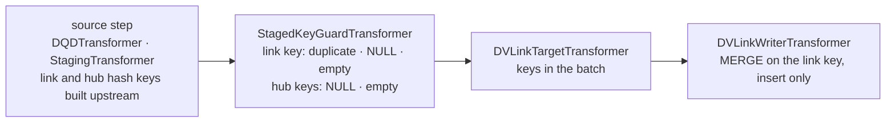

# Design — Data Vault links

**Audience:** public
**Status:** accepted by the owner, 2026-10-01
**Date:** 2026-10-01
**Tracked as:** F167, F168; F169 for the deferred referential check
**Amends:** [the Data Vault design](2026-10-01-data-vault-design.md), decision 2 and "Non-goals":
the link reserved there is built here.
**Depends on:** F159 (the hub steps, whose logic the link shares), F162 (`execute_dv_insert_only`
taking key columns, and its retry flag).

## Overview

A **link** records a relationship between hubs, such as an order and a product: one row per
relationship ever seen, keyed by a link hash key, carrying the hash key of each hub it connects,
`RecordSource`, `LoadTS`, `LoadEndTS` and the audit columns. Canonical Data Vault 2.0, as the
first increment: insert-only, never updated or deleted. A link is loaded by its own run and load
context (`scd_type` `dv_link`), as a hub and a satellite are, from the same staged frame. Its
descriptive attributes, if any, go in a link satellite, which is `dv_satellite` keyed on the link
hash key and needs nothing new. The proposal: two thin link steps sharing the hub writer's logic
through module functions; one new `scd_context` key naming the hub key columns; no load-time
referential check in this increment.

## Goals

- Load a link from one DQD or staging source: the batch's new relationships inserted once, each
  identified by its link hash key, a relationship from a second source not inserted twice.
- Refuse, before any write, a batch whose link hash key or any hub hash key is NULL or empty, and
  a link hash key staged twice.
- Keep `data_vault_style` one string per step, so the composition check, the style refusals and
  their messages stay as they are.
- A link satellite through the existing `dv_satellite_pipeline`, documented in the guide.

## Non-goals

- Building the hash keys in the library. The link hash key and the hub hash keys are built
  upstream, in the DQD or a staging notebook, as `HashKey` is today (decision 5).
- Effectivity satellites (when a relationship ends), same-as links, hierarchical links,
  driving keys, multi-active links: each a later design.
- A load-time referential check that every hub key exists in its hub (Rejected, and the open
  question below).
- Business keys on the link row: the source step selects what the link stores; the guide shows
  hash keys only, as canonical Data Vault 2.0 does, and the library does not enforce it.

## Proposed API

### The steps: three ways, one recommended

| | (a) generalise the hub steps | (b) link steps sharing module functions — **recommended** | (c) subclass the hub steps |
|---|---|---|---|
| Shape | `DVHub*` become insert-once steps for `dv_hub` and `dv_link` | `DVLinkTargetTransformer`, `DVLinkWriterTransformer` in `transformers/dv_link.py`; the hub `_run` bodies move into module functions taking the style | `DVLink*` subclass `DVHub*`, overriding `data_vault_style` |
| `data_vault_style` | becomes a set; `require_data_vault_style` and the orchestrator's composition check change shape | one string per step, unchanged | one string per step |
| Public names | `DVHub*` renamed or aliased | two new names | two new names |
| Cost | the composition contract changes for every Data Vault step | two thin classes per step, repeating the provider attribute declarations | against composition over inheritance (`api-and-typing`); `isinstance(x, DVHubWriterTransformer)` would match a link step |

The data-platform-architect recommended (b), 2026-10-01: it shares the writer's logic without
loosening the one-string style contract the orchestrator relies on, and a hub step composed into a
link load is still refused by name.

| Name | Where | What |
|---|---|---|
| `DVLinkTargetTransformer` | `transformers/dv_link.py` | The link's rows whose link hash key the batch carries, into `state.frames["target"]`, by a semi-join whatever the `load_type`; `None` when the link does not exist. |
| `DVLinkWriterTransformer` | `transformers/dv_link.py` | Inserts the relationships the link lacks, stamped as a hub row is; never updates. Reports `inserted`, `updated` 0, and its run's `LoadTS` as `hwm_after`. |
| `dv_link_pipeline` | `orchestration/pipeline_factory.py` | The source, `StagedKeyGuardTransformer`, the link target and writer. |

### `scd_context`, extended

| Key | Values | Meaning |
|---|---|---|
| `link_hub_key_columns` | list of names | `dv_link` only, and required there: the staged columns holding the hash key of each hub the link connects, at least two, distinct, none equal to `business_key_column` or a load column. Refused under every other style, naming the key and the style, by a new `_DV_LINK_ONLY_KEYS` beside `_DATA_VAULT_ONLY_KEYS`. |

`business_key_column` is the link hash key. `load_type` has no effect on a link, as on a hub.

## Internal design

**The writer** is the hub writer with another style: seal check, anti-join against the target
frame, `stamp_data_vault_columns`, then `execute_dv_insert_only` on the link hash key alone, with
its retry. A retry is safe here, as for the hub: the MERGE's own predicate decides the rows against
the live table, which is the condition the 2026-10-01 lesson on retries sets. A MERGE on the link
key plus the hub keys was rejected by the delta-lake-specialist: with a consistent hash the hub
keys add nothing; with an inconsistent one the wider predicate inserts a second row under one link
key, breaking the key silently, where the key alone skips it. The seal records the hash algorithm,
as on the hub, documenting what the keys were expected to be built with; it cannot verify them.

**The shared logic.** `DVHubTargetTransformer._run` and `DVHubWriterTransformer._run` move into
module functions in `dv_hub.py` that take the style, next to `stamp_data_vault_columns`; the hub
and link classes each call them and declare their own provider attributes inside `_run`
(transformer contract). Nothing in the hub's behaviour changes; its tests prove it.

**The staged-key guard** gains a second list: the uniqueness key stays `business_key_column`; the
not-null columns become the key plus `link_hub_key_columns` under `dv_link`. A hub key repeats
across links by design, so it is never checked for duplicates. Both lists are answered by the one
aggregation the guard runs today, so it costs no further Spark action.

**Optional relationships.** A relationship whose hub business key is missing gets the zero key, a
fixed hash agreed for "no hub row" (canonical Data Vault 2.0), built upstream, never NULL. The
hub then needs one ghost row with the zero key, written once by the pipeline's author; the guide
shows both. The library refuses a NULL hub key rather than choosing a zero key for the author.

*Amended 2026-10-01 by F168: the library does not de-duplicate a hub's or a link's staged keys. A hub loaded from a source at a finer grain (order lines for an order hub) stages its key once per line and is refused by the staged-key guard; a pair staged twice is refused on the link. Unique keys are the source's business logic (the owner, 2026-10-01): each hub reads a source at its own key's grain, and the guide says so.*

## Platform-specific behavior

None new. The link reaches Delta through the adapter methods the hub uses: `delta_table_exists`,
`read_delta`, `write_delta_create`, `resolve_delta_table`, `get_table_properties`,
`set_table_properties`. The live checks the Data Vault design owes cover the link too: whether
Delta raises the conflict for two link loads at once, and clustering (F166).

## Error handling

- `SCDContext.validate`: `dv_link` is accepted; `link_hub_key_columns` missing, empty, with one
  column, duplicated, or colliding with the key or a load column under `dv_link` → `ValueError`
  naming it; set under another style → `ValueError` naming the key and the style.
- `StagedKeyGuardTransformer`: a link key staged twice, or a link or hub key NULL or empty →
  `ValueError` with counts and samples, before any write.
- A link step under another style, or a hub step under `dv_link` → `ValueError` at assembly and
  in `_run`, as today.
- A sealed hash algorithm that differs → `ValueError`, as on the hub.

## Testing strategy

- **Unit**: the context key's acceptance and refusals; the guard's NULL and empty hub keys and its
  silence on a repeated hub key; the link target's semi-join; the writer's branches with the Delta
  work patched out, as `test_dv_hub.py` does; the factory's composition. The hub's unit tests stay
  unchanged and green after the move into module functions.
- **Integration**, local Delta: a link loaded twice from one DQD source, a second source adding
  one relationship and repeating another, a NULL hub key refused before the link exists, a link
  satellite loaded by `dv_satellite_pipeline` on the link key.
- **Architecture**: the new exports and the reference rows.
- Both platform-filtered suites.
- **Not provable here**: concurrent link loads on a live metastore.

## Documentation plan

- `docs/reference/load-context.md`: `link_hub_key_columns`, and `dv_link` no longer refused.
- `docs/reference/transformers.md`: the two link steps; the guard's row.
- `docs/reference/orchestrator.md`: `dv_link_pipeline`.
- `docs/guides/load-a-data-vault-entity.md`: a link and a link satellite, the canonical link key
  expression (the hub business keys in a fixed order, `||` between them), the zero key and its
  ghost hub row, and loading hubs and links from one source.
- `docs/architecture/pipeline-model.md`: the third Data Vault table in "Two target styles".
- `README.md`: the opening paragraph and the Quick Start section name links beside hubs and
  satellites; `docs/architecture/overview.md`'s sentence naming the Data Vault factories gains
  `dv_link_pipeline`.
- The local reference notebook `NB_BI_LoadEntity_DataVault_Gen3.ipynb` gains a link, or a new one
  for a two-hub entity: TransactionHistory to Product is the candidate in `data/`.
- An amendment line in the Data Vault design under decision 2 and "Non-goals", linking here.

*Amended 2026-10-01 by F168: the link has a guide of its own, `load-a-data-vault-link.md`, rather than a section of `load-a-data-vault-entity.md`: connecting two hubs is another task (the writing-guides skill, one task per guide). Its canonical link key hashes the hubs' business keys, normalised as each hub's key is, joined by `||` (the owner, 2026-10-01); a missing business key hashes as the empty string, a fixed key with its one hub row, so the zero key is the canonical expression's own.*

## Rejected

- **A MERGE on the link key and the hub keys**: see Internal design.
- **Quarantining orphan links**: an insert-only vault loses the relationship until someone replays
  it, silently (the delta-lake-specialist).
- **Generalising the hub steps, or subclassing them**: Proposed API, options (a) and (c).
- **Hub business keys on the link row as a requirement**: not canonical; the source chooses.

## Open questions

*Answered by the owner, 2026-10-01, accepting the recommendations: the referential check is
deferred to an opt-in step of its own (F169); the guide's canonical link key expression is the
control for an inconsistent key, with no check in this increment.*

1. **A load-time referential check.** The proposal relies on run order: every source feeding a
   link also feeds each of its hubs, and canonical Data Vault 2.0 loads hubs, links and satellites
   in parallel with no enforced foreign key. The alternative is an opt-in step, composed in or left
   out as `CandidateGuardTransformer` is, that anti-joins each hub key against its hub and refuses
   the batch on an orphan: one near-full hub scan and one action per hub (hash keys defeat file
   skipping), and a false refusal when a hub load has not committed yet. It needs a second
   `dv_link`-only key mapping each hub key column to its hub's table. Defer, or build with this
   increment?

   *Amended 2026-10-04 by F169: no opt-in check is built; the limitation is documented in the link guide, the writer's docstring and the transformers reference.*
2. **The inconsistent link key.** The same link key with different hub keys is cheap to catch (keep
   the hub keys in the target read; one action comparing them on matched rows) but arises only
   from a bug. The same hub keys under a different link key, the realistic drift (column order,
   separator, case), is not cheap to catch, and the key cannot be sealed because it is built
   upstream. Is the guide's canonical expression enough for now?
