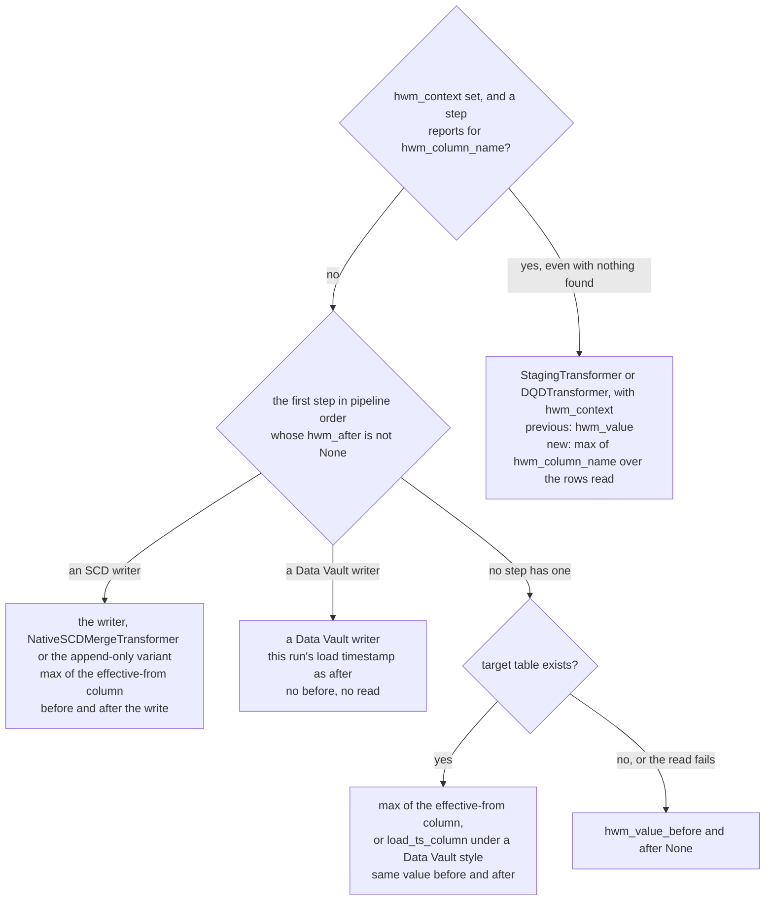

# Metrics and watermarks

How a run measures itself and what each measurement costs, for someone adding a step, a writer
or a capture flag: the per-stage metrics every step records, the write and source counts, and the
high watermark a run reports. It covers `transformers/base.py` (`before_run`, `after_run`),
`orchestration/metrics.py`, `orchestration/load_pipeline.py` (`capture_merge_statistics`,
`capture_write_statistics`, `get_high_watermark`), the harvest in `LoadOrchestrator.run` and
the source steps' watermarks in `transformers/staging.py` and `transformers/dqd.py`. The fields themselves are on the
[execution-result reference](../reference/execution-result.md); the cost rules are the
[spark-delta-cost rule](../../.claude/rules/spark-delta-cost.md).

## Per-stage metrics

Every step records one `StageMetrics` when it completes, from `_TransformerBase.after_run`, into
the run's `StageMetricsCollector`; the list becomes `ExecutionResult.stages`. `duration_ms` is the
step's wall time with the instrumentation included, and `measure_ms` is how much of that the
instrumentation took, so a slow measurement is visible rather than blamed on the step. What the
instrumentation does is chosen by three `runtime_context` flags:

| Flag | Default | Measures | Cost |
|---|---|---|---|
| `capture_partitions` | on | `partitions_in`, `partitions_out` | Free on a narrow plan. On a plan with a shuffle, reading the count runs the shuffle; one stage was measured at 117 s. |
| `capture_row_counts` | off | `row_count_in`, `row_count_out` | A `count()` on entry and on exit: up to two Spark actions per step; a source step has no entry count. |
| `capture_plans` | off | `plan` | Plan analysis only, no Spark action. |

The merge writer adds `inserted` and `updated` to its own stage through `after_run(extra_metrics=...)`;
the append-only writer adds `inserted` only. The Data Vault writers add neither to their stage: their
counts reach the run's `ExecutionMetrics` through the harvest below, not `StageMetrics`.
The other count fields of `StageMetrics` exist for custom steps; no shipped step sets them.

## Write counts

A writer never counts rows. It notes the target's Delta version before it writes, and afterwards
`capture_merge_statistics` (for a `MERGE`) or `capture_write_statistics` (for a plain append)
reads the newest matching commit after that version from the table's history, and takes
`numTargetRowsInserted` and `numTargetRowsUpdated`, or `numOutputRows`, from its
`operationMetrics`. That is two small history reads, the version before and the commit after, in
place of a second pass over the data, which is what the spark-delta-cost rule asks for.

## Source counts

`source_count` and `target_count` come from the source step. `StagingTransformer` adds up the
counts each staging notebook reports in its own result, at no cost here. `DQDTransformer` counts
only when the load has an `hwm_context`: the rows it passed on, in the same aggregation that
finds the watermark, so no extra Spark action (backlog F144). Without one, both are `0`, the same
as an empty source.

## The high watermark

The watermark is the value the next incremental load starts from. When the load context has an
`hwm_context`, the orchestrator takes it from the first `HWMProvider` that reports for its
`hwm_column_name`, whatever it found (F138). Otherwise, or when no step reports for that column, it
takes it from the first step, in pipeline order, that is an `HWMProvider` whose `hwm_after` is not
`None`; `hwm_after` only selects the watermark, it does not prove that a step ran (F117). The counts are harvested separately, from the first
`SCDMetricsProvider` whose `inserted` and `updated` are not `None`: a provider declares them `None`
in `__init__` and sets them in `_run`, so a branch that never ran is skipped and a writer whose
watermark read failed is still counted. Wrappers are unwrapped first.

Read it as: with a load-context `hwm_context`, the staging or DQD source that reports for its
column owns the watermark, even when it found none; otherwise the writer's is used, read from the table by an
SCD writer and stated without a read by a Data Vault one; and when no step has one, as on an early exit or when the writer's reads failed,
the orchestrator reads the target itself, one existence check and one full-table aggregation.
`""` means a table that exists and is empty.

Three consequences follow from how the values are read:

- **The SCD writer's watermark is a full-table maximum.** `get_high_watermark` aggregates the
  effective-from column over every row of the target, all versions included, before the write when
  the target exists and again after it: up to two Spark actions. A failure in either is swallowed with a warning in the log and leaves that value
  `None`; the writer's counts are unaffected, because the harvest proves the writer ran by its
  counts and not by `hwm_after` (F117).
- **A Data Vault writer's watermark is this run's load time.** The hub, link and satellite writers
  report this run's load timestamp as `hwm_after`, on `load_ts_column`, and `None` as `hwm_before`. They
  read nothing for it, so it costs no Spark action.
- **The staging and DQD watermarks describe the rows read.** With `hwm_context` set,
  `DQDTransformer` filters its source to `hwm_column_name > hwm_value` and reports the same way;
  `StagingTransformer` leaves the filter to the staging function and reports its `hwm_value` as the previous value and the maximum of
  `hwm_column_name` over the staged rows, formatted by Spark in the session time zone, as the
  new one: one aggregation. Nothing staged keeps the previous value. With `hwm_context` set,
  the step that reported for `hwm_column_name` owns the watermark even when it found none, so a
  first run that staged nothing reports `None` rather than the writer's load time. Without
  `hwm_context` the step reports nothing, and the harvest is as before.

## Why it is this shape

Reading counts from commit metadata and gating every other measurement behind a flag both answer
measured cost; the reasoning and the incidents are in the
[spark-delta-cost rule](../../.claude/rules/spark-delta-cost.md). Why a step's attributes are set inside `_run` is in the [transformer-contract rule](../../.claude/rules/transformer-contract.md).

## See also

- [Pipeline model](pipeline-model.md): how steps declare what they report.
- [Execution-result reference](../reference/execution-result.md): every metric field.
- [Load-context reference](../reference/load-context.md#runtimecontext): the capture flags.
