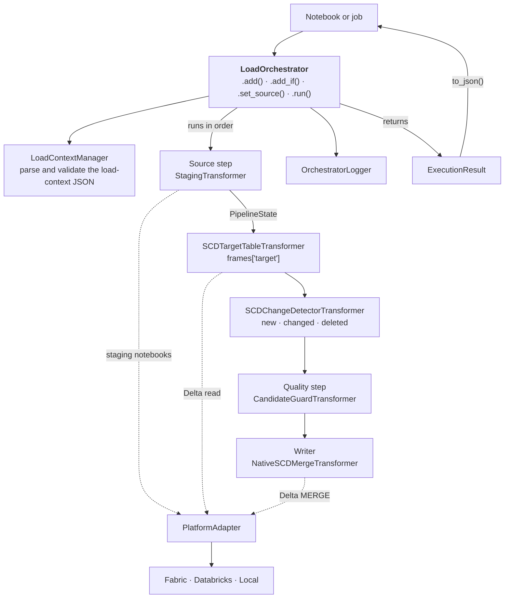

# Overview

How one entity load moves through the library, for someone changing it: what
`LoadOrchestrator` does with a load context, how the transformer pipeline passes data from step to
step, where the platform is reached, and what comes back. It covers `orchestration/`,
`orchestration/transformers/`, `adapters/` and `logger/`. Which module may import which is the
subject of CLAUDE.md §2 and the [layering rule](../../.claude/rules/layering.md), not of this page.

## The shape

Follow a load from the notebook down the pipeline and back out as a result; the adapter on the
right is the only way any step reaches the platform.

Read it as: the orchestrator parses the context once and hands the same read-only `LoadContext` to
every step; each step takes a `PipelineState` and returns a new one; every read, write and notebook
run goes through the adapter; and whatever happens, `run()` returns an `ExecutionResult` rather
than raising. The steps drawn are `default_pipeline`'s; `dv_hub_pipeline`, `dv_link_pipeline` and `dv_satellite_pipeline` compose the Data Vault
steps instead
(see [Two target styles](pipeline-model.md#two-target-styles)), and a pipeline built by hand can
hold any steps.

## The orchestrator

`LoadOrchestrator` owns one run. Its constructor only records the load-context JSON and resolves
the adapter; nothing is parsed until `run()`. Resolving the adapter is the one place the entry
point raises: an unknown `platform`, or one whose adapter a filtered build removed, is a
`ValueError` from the constructor, outside `run()`. `run()` parses and validates the context,
builds the logger from `logging_context`, injects the Spark session, adapter, logger and metrics
collector into every transformer (a plain `(DataFrame, LoadContext)` callable gets none, and is not
skipped on a halted pipeline), runs the steps, collects the watermark and the write counts from the steps that
report them, and returns the result. Every exception inside becomes a result with `status`
`"error"`. Its parameters and methods are on the [orchestrator reference](../reference/orchestrator.md).

## The pipeline

A pipeline is one source step followed by process steps, each taking a `PipelineState` and
returning a new one; a step halts the load by returning a halted state, and reports its write
counts and watermark by declaring attributes the orchestrator reads after the run. How steps are
built, run, halted, wrapped, given their services and harvested is the
[pipeline model](pipeline-model.md); every shipped step is on the
[transformer reference](../reference/transformers.md).

## The platform boundary

No step, and nothing in `orchestration/`, calls a platform SDK: every notebook run, path deletion
and Delta read or write goes through `PlatformAdapter`, whose concrete class the orchestrator
imports by name only when it needs it. How the adapters are shaped, chosen and stripped from a
single-platform build is the [platform abstraction](platform-abstraction.md).

## Logging and the result

`OrchestratorLogger` writes through a `LogSession` when the platform gives it somewhere to persist
logs, and to a plain Python logger otherwise; `run()` finalizes it once, success or failure, and
puts its JSON in `ExecutionResult.logs`. The result also carries the status, the error, the load's
metrics and one `StageMetrics` per step that ran. See the [logging reference](../reference/logging.md) and
the [execution-result reference](../reference/execution-result.md).

## Why it is this shape

The audit that checked the current boundaries against the code, and the findings that came from
it, are in the [2026-09-25 architecture audit](decisions/2026-09-25-architecture-audit.md); the backlog carries
each finding's history.

## See also

- [Repository layout](repository-layout.md): where each module lives.
- [Load-context reference](../reference/load-context.md): what the load-context JSON holds.
- [Orchestration user guide](../guides/orchestration-user-guide.md): building and running a pipeline.
