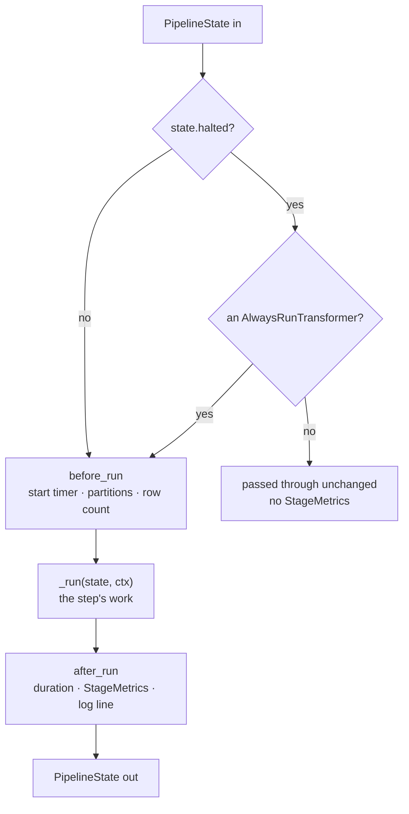

# Pipeline model

How a pipeline of transformers is built and run, for someone writing a step or changing the
runner: the state that passes between steps, the two kinds of step and the templates that run
them, halting, service injection, and the wrappers. It covers `orchestration/transformers/`
(`base.py`, `state.py`, `conditional.py`, `conditional_source.py`) and
`LoadOrchestrator._run_pipeline` in `orchestration/orchestrator.py`. The constraints a step keeps
are the [transformer-contract rule](../../.claude/rules/transformer-contract.md); this page
explains them.

## The shape

One step's run, from the moment the runner reaches it: look at where a halted state leaves, and
at which parts a subclass may replace.

Read it as: `ProcessTransformer.__call__` is the template, and a subclass fills in `_run` and may
extend `before_run` and `after_run`, never `__call__` itself. A source step runs the same way
through `SourceTransformer.produce`, with a column check between `_produce` and `after_run`, and
is never skipped, because it runs first.

## State between steps

`PipelineState` is a small dataclass: `df`, the rows flowing through; `frames`, named side
frames, such as the target table under `"target"`; `halted` with `halt_reason`; and
`target_exists`, which is `None` until a target step runs, then `True` when the target frame is
present (possibly empty) or `False` when the table does not exist and the key is absent. `frames`
never holds `None`: a target step states an absent table with `with_target(None)`. Three more
fields carry what one step tells a later one: `debug_columns`, the columns a detector added for
inspection, which the writer drops before it writes; `hash_separator`, the separator the change hash
used, which the writer seals on the table; and `cached`, the frames a step persisted, which the
orchestrator releases when the run ends. It is
immutable by convention. A step returns a new state from `with_df`, `with_frame`, `with_target`,
`with_halted`, `with_updates`, `with_debug_columns`, `with_hash_separator` or `with_cached` and
never changes the one it was given, so a step can keep a reference to its input
without it shifting under it. Of the names steps share across that state, the `"target"` frame key
and the `_change_type` and `_prev_scdVersion` columns are defined once in
`transformers/_constants.py`; the debug columns, the hash separator and the cached frames are
fields, with no shared name to define. The [data-contract rule](../../.claude/rules/data-contract.md)
lists all five channels and says why a second copy of a name is a bug.

`LoadContext` is the other input: the parsed load context, built once by the runner and passed
unchanged to every step. It is frozen, and the context objects inside it are read-only to steps
by convention.

## Two kinds of step

A pipeline is exactly one `SourceTransformer` at position 0, then any number of
`ProcessTransformer`s. The runner checks this at the start of `_run_pipeline`, after the load
context is parsed and validated: no source first, or a source later on, is an error result.

- A **source** implements `_produce(ctx)` and returns the first state. `produce()` wraps it: it
  times the step, and after `_produce` it checks that `df` has the business-key column, and the
  source-system column when that comes from the source. The deleted-flag column is optional.
- A **process step** implements `_run(state, ctx)`. `__call__` wraps it as drawn above.
- A step that must report on a halted pipeline, such as a chart or plan printer, subclasses
  `AlwaysRunTransformer`; its `__call__` ignores `halted`. It is the only sanctioned way past the
  halt, and it must not change the state.
- A plain callable taking `(DataFrame, LoadContext)` and returning a `DataFrame` is accepted after
  position 0 as a shim: its result replaces `df`. It gets no services, records no metrics, and is
  not skipped on a halted pipeline.

## Halting is data

A step stops the pipeline by returning `state.with_halted(reason)`, not by raising.
`CandidateGuardTransformer` does this when there are no candidates. Every later process step then
passes the state through, and `run()` reports `early_exit` and `early_exit_reason` in a result
whose `status` is still `"success"`. An exception is the other way out, and it becomes a result
with `status` `"error"`.

## Services are injected, not constructed

A step's constructor takes only its own options. The Spark session, the adapter, the logger, the
metrics collector, the step's position (`_stage_index`) and, for steps that have the attribute,
the context manager are set on it by the runner just before the source runs. So a step can be
built before any session exists. A step tolerates a missing logger by falling back to a fresh `OrchestratorLogger`.

## Wrappers

`.add_if()` wraps a step in `ConditionalTransformer`, and `.set_source()` wraps two sources in
`ConditionalSourceTransformer`. Both route rather than run: the wrapper passes its services on and
calls the chosen inner step, whose own lifecycle runs once, under its own name, with its own
metrics and its own halt behaviour. A step whose predicate is false records no stage at all.
Because the reporting attributes live on the inner step, the orchestrator unwraps both kinds
before it reads the watermark and write counts; a new wrapper must be added to that unwrapping
or its inner step's metrics are lost.

## Reporting

A step reports what it did by declaring attributes, not by registering: a writer sets `inserted`
and `updated`, and a step that knows the high watermark sets `hwm_before`, `hwm_after` and
`hwm_column`. The capabilities are protocols, and the invariants the harvest depends on are in the
[transformer-contract rule](../../.claude/rules/transformer-contract.md#optional-capabilities--protocols-not-base-classes).
How the orchestrator chooses among them, and what each measurement costs, is
[metrics and watermarks](metrics-and-watermarks.md).

## Two target styles

The runner is the same for every load; the load context's `scd_context.scd_type` picks the
steps. The SCD styles (`scd1`, `scd2`) run `SCDTargetTableTransformer`,
`SCDChangeDetectorTransformer` and a native SCD writer such as `NativeSCDMergeTransformer`, and keep one current row per key,
updated in place or versioned. The Data Vault styles run their own steps, composed by
`dv_hub_pipeline`, `dv_link_pipeline` and `dv_satellite_pipeline`, and only ever insert: a hub takes a
key once, a link takes a relationship between hubs once, and a satellite takes a new row for each change, delete or reappearance, its current state being the
row with the latest load timestamp (`load_ts_column`). A step built for one style refuses the other, at the start of `_run_pipeline`, before the source
reads anything, and again in its own `_run`; a step inside `.add_if()` is left to its own `_run`
check, since it may never run. Either way a wrongly composed pipeline fails before it writes.

Row identity differs by style, deliberately: SCD tells entities apart by business key and source
system, Data Vault integrates them by business key alone, and neither model is forced on the
other. The routing column `_change_type` and the `"target"` frame are shared by both, under the
[data-contract rule](../../.claude/rules/data-contract.md). Why the styles share one
`scd_context` and one runner is in the
[Data Vault design](decisions/2026-10-01-data-vault-design.md), and the link's in the
[link design](decisions/2026-10-01-data-vault-link-design.md).

## Why it is this shape

The immutable state, the template methods and the injected services came before the dated
records; what the audit found them to guarantee, and the findings that tightened them (F2, F3,
F24 and F29 among them), are in the
[2026-09-25 architecture audit](decisions/2026-09-25-architecture-audit.md) and in each finding's
log in the backlog.

## See also

- [Overview](overview.md): where the pipeline sits in a load.
- [Transformer reference](../reference/transformers.md): every shipped step and its parameters.
- [Orchestrator reference](../reference/orchestrator.md): `add`, `add_if`, `set_source` and `run`.
