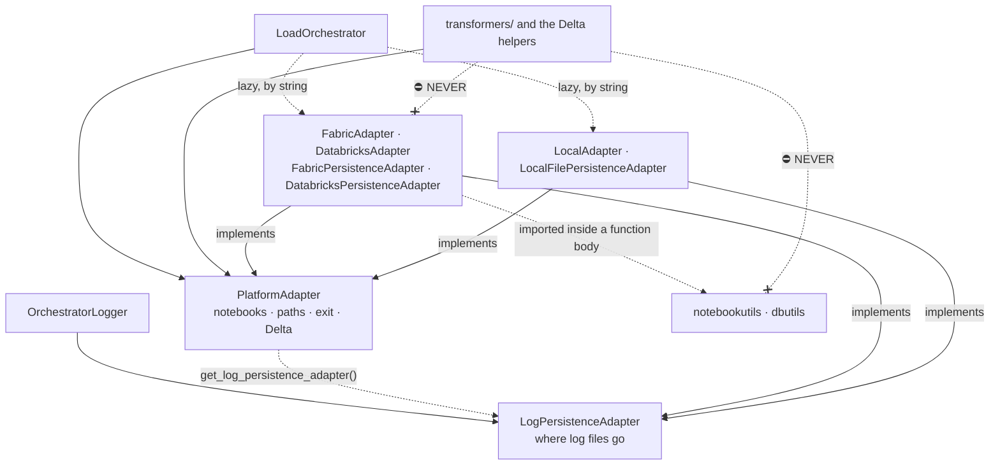

# Platform abstraction

How the library runs unchanged on Microsoft Fabric, Azure Databricks and a local machine, for
someone adding a platform call or a platform: where platform code may live, how an adapter is
chosen, and how a build with one platform removed still imports. It covers `adapters/`, the
persistence adapters in `spark_logging/`, the adapter resolution in `orchestration/orchestrator.py`,
the `local_notebookutils/` stub and `scripts/filter_platform_release.sh`. The constraints are the
[platform-boundary rule](../../.claude/rules/platform-boundary.md) and the
[dual-shipping rule](../../.claude/rules/dual-shipping.md); this page explains them.

## The shape

Look at which way the arrows point: the core depends on the two interfaces, the orchestrator
reaches a concrete adapter by name at run time, and only the Fabric and Databricks classes touch a
platform SDK. Two other places name a concrete adapter, each inside a function body and not drawn:
`create_staging_main_function` in `orchestration/staging_pipeline.py` builds a `FabricAdapter` when
no adapter is passed, and `spark_logging/databricks_persistence.py` borrows `_get_dbutils` from
`adapters/databricks_adapter.py`, both files being Databricks-only in a filtered build.

Read it as: steps and helpers call only `PlatformAdapter`; the orchestrator builds a concrete
adapter from a string; a platform SDK is imported only inside a function in the Fabric and
Databricks classes, never at module level; and the crossed edges are the bans on the rest of the
library touching an SDK or naming a concrete adapter. The logger writes through
`LogPersistenceAdapter`, which the platform adapter proposes; the local classes implement the same
interfaces with no SDK. Each class node holds an adapter and a persistence adapter, which
implement one interface each.

## Two interfaces

`PlatformAdapter` is what a load needs from a platform: run a notebook or a set of them, delete a
path, name the running notebook, end it with a value, say where logs persist, read Delta, Parquet
or a catalog table, write, create and drop Delta, check a path for content, read and set table
properties, and read a Fabric Warehouse view. The notebook, path, exit and log methods differ per
platform, and `read_warehouse_view` is overridden by `FabricAdapter` alone, every other platform
refusing it; the table and Delta methods have one portable implementation on the interface. `LogPersistenceAdapter` is
smaller: make a directory, write a file, copy a file, and optionally end the notebook, name it or
supply a Spark session. The two are separate: `spark_logging` imports nothing from `adapters/` at
module level, so a staging notebook can log with it on its own; the one import, inside a function of
`DatabricksPersistenceAdapter`, is above. For a load, the platform adapter proposes one through
`get_log_persistence_adapter`, and `OrchestratorLogger` overrides it with
`LocalFilePersistenceAdapter` when `log_file_dir` is an absolute POSIX path, on any platform, or
logs without persisting when the proposal is `None`. Their members are on the
[platform-adapter reference](../reference/platform-adapters.md) and the
[logging reference](../reference/logging.md).

Adding a platform capability is rule 3 of the
[platform-boundary rule](../../.claude/rules/platform-boundary.md).

## Choosing an adapter

A caller passes an adapter to `LoadOrchestrator`, or a `platform` string. The string is looked up
in `_PLATFORM_MAP`, which holds dotted paths, and the module is imported only then. So the core
never imports a concrete adapter, and adding a platform is one map entry. The values are on the
[orchestrator reference](../reference/orchestrator.md#loadorchestratorplatform).

## Builds for one platform

`scripts/filter_platform_release.sh` produces a Fabric-only and a Databricks-only build by deleting
the other platform's adapter and persistence modules, the local adapter and stub, and their tests.
`spark_logging/local_persistence.py` stays in both builds: it is platform-neutral, and the logger
substitutes it when the platform proposes a persistence adapter and `log_file_dir` starts with `/`.
The package must still import afterwards, so `adapters/__init__.py` and `spark_logging/__init__.py`
import each concrete class inside `try`/`except ImportError`, bind the name to `None` when it is
missing, and leave it out of `__all__` where there is one. A load that asks for the deleted
platform gets a `ValueError` from the orchestrator's constructor that says the build is filtered,
not a bare missing-module error. The script is the one definition of what each build keeps.

## Tables by name or by path

Every Delta method takes one identifier, a Unity Catalog name or a filesystem path, and routes it
itself: `is_table_identifier` says which, so a caller never branches on it. An absolute path, a
Windows drive or UNC path, any `scheme://` URI, or a `dbfs:/` or `file:` prefix is a path; anything
else, including a relative path, is a table name. The prefixes are in the
[`is_table_identifier` row](../reference/platform-adapters.md#platformadapter) of the
platform-adapter reference.

## Running notebooks locally

`LocalAdapter` runs staging notebooks as registered Python callables or as `.ipynb` files. For
notebook code that calls `notebookutils` itself, `local_notebookutils` puts a stand-in module into
`sys.modules`. It is the one exemption the
[platform-boundary rule](../../.claude/rules/platform-boundary.md) carries: it never imports an
SDK, it injects one.

## Why it is this shape

Portability is the product (CLAUDE.md §1): a change that works on one platform only is a bug
unless it sits behind an adapter. The findings that closed the leaks the audit found — `dbutils`
outside the adapters (F1), identifier routing past the adapter (F6), the lost resolution message
in a filtered build (F5) — are in the
[2026-09-25 architecture audit](decisions/2026-09-25-architecture-audit.md) and the backlog.

## See also

- [Overview](overview.md): where the adapter sits in a load.
- [Platform-adapter reference](../reference/platform-adapters.md): every method and who overrides it.
