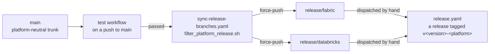

# Release branches

How a platform-specific release is built from the one platform-neutral trunk, for someone changing
the library or its CI. It covers the two release branches, the script that defines them, the
workflows that build and publish them, and the guards that keep the trunk whole. The constraint
itself, never branch from a release branch, is the
[release-and-branching rule](../../.claude/rules/release-and-branching.md); this page explains it.
The steps to publish a release are the guide [Cut a release](../guides/cut-a-release.md).

## The shape

Follow a commit from `main` to a published wheel. Only the trunk is ever edited; everything to the
right of it is regenerated.



Read it as: a release branch is a filtered copy of a tested commit on `main`, and a wheel is built
from a release branch without running a test.

## The trunk

`main` is the only platform-neutral branch. Every adapter, every platform's log persistence and
every test lives there, and it is the only branch pull requests target.

## The release branches

`release/fabric` is `main` without the Databricks adapter and log persistence, the local-only
adapter and `local_notebookutils/`, and the tests that exercise them. `release/databricks` is the
mirror image. Both also drop `tests/architecture/`, which describes the complete trunk and has no
meaning on a filtered one, and the `local` extra from `pyproject.toml`
(`scripts/_strip_pyproject_local_extra.py`), whose packages serve only the local adapter. A
release wheel therefore cannot run a load locally; local development uses a checkout of `main`
or a source copy.

The exact paths live in one place, `scripts/filter_platform_release.sh`, and are not repeated
here or anywhere else. To see them:

```bash
scripts/filter_platform_release.sh fabric --list
scripts/filter_platform_release.sh databricks --list
```

`spark_logging/local_persistence.py`, which holds `LocalFilePersistenceAdapter`, ships on every
release branch. It is platform-neutral in practice: `OrchestratorLogger` uses it on Fabric and
Databricks whenever the log directory is a locally mounted path, such as `/Volumes/...`,
`/dbfs/...` or `/tmp/...`. Only `adapters/local_adapter.py` and `local_notebookutils/` are
local-development code.

## Building and publishing

- **`sync-release-branches.yaml`** runs when the test workflow completes on a push to `main`, and
  only when that run passed. It checks out the commit the tests passed, not `main`'s tip, resets
  each release branch to it, runs the filter script, commits and force-pushes. It never moves a
  release branch backwards: a tested commit older than the one a branch was last synced from is
  skipped.
- **`platform-builds.yaml`** filters a checkout the same way and runs the suite on what is left.
  It runs only when started by hand, so a synced release branch has passed the full suite on
  `main`, not its own filtered suite, unless someone ran it.
- **`release.yaml`** is started by hand on `release/fabric` or `release/databricks`, refuses to
  run when its `platform` input does not match the branch, reads the version from
  `pyproject.toml`, builds the wheel and publishes it as the GitHub Release
  `v<version>-<platform>`. It runs no tests.

## The guards

A release branch is a filtered tree, so a branch cut from one carries that platform's deletions,
and merging it back strips the other platform's files out of `main`. That happened once, in August
2026: `main` lost its Fabric adapter, the default `LoadOrchestrator(platform="fabric")` raised
`ModuleNotFoundError`, and the sync then regenerated `release/fabric` from the damaged trunk.
Three guards now cover it:

| Guard | Where | Catches |
| --- | --- | --- |
| `scripts/verify_trunk_complete.sh` | the `guard-trunk` job, on pull requests and pushes to `main`, and a pre-flight step in the sync job | any platform path missing from the trunk, whatever the cause |
| release-sync commit check | the `guard-trunk` pull-request job | a branch cut from a release branch, and says so |
| empty-filter check | the sync job | a `main` that is already filtered, because filtering a complete trunk always removes something |

The expected path set is not kept separately: it is the union of both platforms' exclusion lists,
read through `scripts/filter_platform_release.sh <platform> --list`.

## Why it is this shape

One trunk keeps every platform's code under one test suite and one review, so a change cannot
work on one platform and silently break the other. The filtered branches give each platform a
wheel without the other platform's adapter. The script is the single definition of what each
platform excludes because a second copy drifted once: an earlier list in the README named test
directories that had since moved. Publishing installs from a GitHub Release wheel rather than PyPI
is recorded in the
[public-release-readiness decision](decisions/2026-10-15-public-release-readiness.md).

## See also

- [Cut a release](../guides/cut-a-release.md), the steps
- [Repository layout](repository-layout.md), where the scripts and workflows live
- [Platform abstraction](platform-abstraction.md), why the adapters can be deleted from a build
